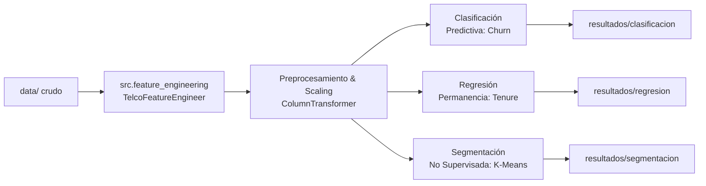

# Telco Customer Analytics & Machine Learning Pipeline

[](https://www.python.org/downloads/)
[](https://scikit-learn.org/)
[](https://pandas.pydata.org/)
[](https://xgboost.readthedocs.io/)
[]()

Pipeline integral de Machine Learning para el análisis, predicción de fuga (*churn*), estimación de permanencia (*tenure*) y segmentación no supervisada de clientes en el sector de telecomunicaciones.

Este repositorio implementa un flujo modular y reproducible que combina ingeniería de características desacoplada, preprocesamiento compatible con la API de Scikit-Learn y modelado predictivo multienfoque.

---

## 📌 Arquitectura del Pipeline

El sistema sigue un flujo end-to-end estructurado:



1. **Ingesta y Limpieza:** Tratamiento de nulos en `TotalCharges`, corrección de tipos e imputación estratégica.
2. **Feature Engineering:** Transformador desacoplado (`TelcoFeatureEngineer`) que calcula métricas de fricción de pago, evolución tarifaria y scores de riesgo contractual.
3. **Modelado Especializado:**
   * **Clasificación:** Detección de fuga orientada a maximizar sensibilidad (*Recall*) para mitigar falsos negativos de negocio.
   * **Regresión:** Estimación de antigüedad (`tenure`) optimizada bajo Error Absoluto Medio (*MAE*).
   * **Clustering:** Agrupación con $K\text{-Means}$ ($k=3$) para perfilamiento de clientes.
4. **Exportación de Artefactos:** Generación automática de matrices de confusión, curvas ROC, curvas de regresión y proyecciones PCA.

---

## 🛠️ Stack Tecnológico

| Capa / Función | Tecnologías |
|---|---|
| **Lenguaje Core** | Python 3.12+ |
| **Manipulación y Análisis** | `pandas`, `numpy`, `scipy` |
| **Modelado de ML** | `scikit-learn`, `xgboost`, `kneed` |
| **Visualización** | `matplotlib`, `seaborn` |
| **Entorno de Experimentación** | `JupyterLab`, `ipykernel` |

---

## 📂 Estructura del Repositorio

```text
.
├── data/
│   ├── Telco_Customer_Churn_Dataset_crudo.csv       # Dataset fuente
│   ├── Telco_Customer_Churn_limpio_segmentacion.csv  # Dataset preprocesado para clustering
│   └── README.md                                    # Diccionario y notas de datos
├── docs/
│   ├── Informe Técnico Implementación...md          # Informe técnico detallado y fundamentación
│   ├── cambios.md                                   # Registro de versiones y cambios
│   └── README.md
├── modelos/                                         # Almacén de modelos serializados (.pkl, .joblib)
├── notebooks/
│   ├── proyecto_semestral.ipynb                     # Notebook principal reproducible
│   └── README.md
├── resultados/
│   ├── clasificacion/                               # Matrices de confusión, curvas ROC, métricas
│   ├── regresion/                                   # Métricas de error y gráficos de dispersión
│   ├── segmentacion/                                # Método del codo, siluetas y proyecciones PCA
│   └── README.md
├── src/
│   ├── feature_engineering.py                       # Clase TelcoFeatureEngineer (compatible sklearn)
│   ├── visualizaciones.py                           # Funciones modulares de evaluación gráfica
│   └── README.md
├── requirements.txt                                 # Dependencias del proyecto
└── README.md                                        # Documento actual
```

---

## 🚀 Instalación y Quickstart

### 1. Clonar el repositorio

```bash
git clone https://github.com/tu-usuario/telco_customer-Modelos-de-Machine-Learning.git
cd telco_customer-Modelos-de-Machine-Learning
```

### 2. Configurar el entorno virtual

* **En Windows (PowerShell):**
  ```powershell
  python -m venv .venv
  .venv\Scripts\Activate.ps1
  ```

* **En Linux / macOS (bash/zsh):**
  ```bash
  python3 -m venv .venv
  source .venv/bin/activate
  ```

### 3. Instalar dependencias

```bash
pip install --upgrade pip
pip install -r requirements.txt
```

### 4. Ejecutar el proyecto

Inicia el entorno de Jupyter para reproducir el pipeline completo:

```bash
jupyter lab notebooks/proyecto_semestral.ipynb
```

---

## 💻 Uso de Módulos Core (`src/`)

El módulo [`src/feature_engineering.py`](src/feature_engineering.py) define transformadores conformes con la interfaz estándar de Scikit-Learn (`fit` / `transform`):

```python
import pandas as pd
from src.feature_engineering import TelcoFeatureEngineer

# Cargar dataset crudo
df = pd.read_csv("data/Telco_Customer_Churn_Dataset_crudo.csv")

# Instanciar e invocar el transformador
engineer = TelcoFeatureEngineer(drop_original=True)
df_features = engineer.transform(df)

# Variables generadas automáticamente:
# - Total_Servicios_Extra (suma de servicios de valor agregado)
# - Pago_Automatico (indicador booleano de métodos automáticos)
# - Vive_Solo (interacción Partner + Dependents)
# - Aumento_Tarifa (MonthlyCharges vs histórico promedio)
# - Perfil_Alto_Riesgo (Month-to-month + Fiber optic)
```

Para generar visualizaciones estandarizadas de evaluación:

```python
from src.visualizaciones import plot_matriz_confusion, plot_curva_roc

# Graficar matriz de confusión normalizada
plot_matriz_confusion(y_test, y_pred, labels=['No Churn', 'Churn'])

# Graficar curva ROC con cálculo de AUC
plot_curva_roc(y_test, y_proba)
```

---

## 📊 Benchmarks de Modelos

### 1. Clasificación de Churn (Optimización por Recall)

El foco operativo del negocio consiste en minimizar los falsos negativos (fugas no anticipadas):

| Modelo | Accuracy | Precision | Recall | F1-Score | ROC-AUC | Falsos Negativos |
|---|:---:|:---:|:---:|:---:|:---:|:---:|
| **Árbol de Decisión (Optimizado)** | 71.3% | 0.476 | **0.824** | **0.603** | 0.827 | **66** |
| Regresión Logística | 72.2% | 0.486 | 0.791 | 0.602 | **0.831** | 78 |
| SVM (Kernel RBF) | **73.4%** | **0.499** | 0.767 | 0.605 | 0.813 | 87 |

### 2. Regresión de Permanencia (`tenure`)

Estimación del tiempo de retención esperado en meses:

| Modelo | $R^2$ (Coeficiente de Determinación) | MAE (Error Absoluto Medio) |
|---|:---:|:---:|
| **Árbol de Decisión (Regressor)** | **92.6%** | **4.71 meses** |
| Regresión Lineal | 87.6% | 6.79 meses |

### 3. Segmentación No Supervisada ($K\text{-Means}$)

* **Número de clusters óptimo:** $k = 3$ (determinado mediante método del codo e inercia).
* **Silhouette Score:** 0.2816.
* **Perfiles detectados:**
  * **Cluster 0 (Nuevos / Transición):** Baja permanencia, contratos mes a mes, alta tasa de churn.
  * **Cluster 1 (Fidelizados Digitales):** Alta permanencia, múltiples servicios contratados, facturación alta, bajo churn.
  * **Cluster 2 (Básicos / Tradicionales):** Solo telefonía básica, baja facturación, permanencia moderada.

---

## 📁 Artefactos Generados

Los gráficos y resultados se encuentran versionados en sus respectivos directorios:

* [`resultados/clasificacion/`](resultados/clasificacion/): Curvas ROC, matrices de confusión y feature importance.
* [`resultados/regresion/`](resultados/regresion/): Gráficos de residuos y ajuste predicho vs. real.
* [`resultados/segmentacion/`](resultados/segmentacion/): Gráfica de inercia (codo), coeficientes de silueta y mapas PCA 2D/3D.

---

## 📖 Documentación Extendida

Para consultar el análisis teórico, la justificación de supuestos de negocio y el desglose metodológico completo:

* 📄 [Informe Técnico Completo](docs/Informe%20Técnico%20Implementación%20de%20Modelos%20de%20Machine%20Learning%20en%20Telecomunicaciones.md)
* 📝 [Historial de Cambios](docs/cambios.md)

---

## 👥 Autores

* **Felipe Huincaman**
* **David Ramírez Luna**

*Proyecto desarrollado en el marco de la asignatura de **Machine Learning**.*
