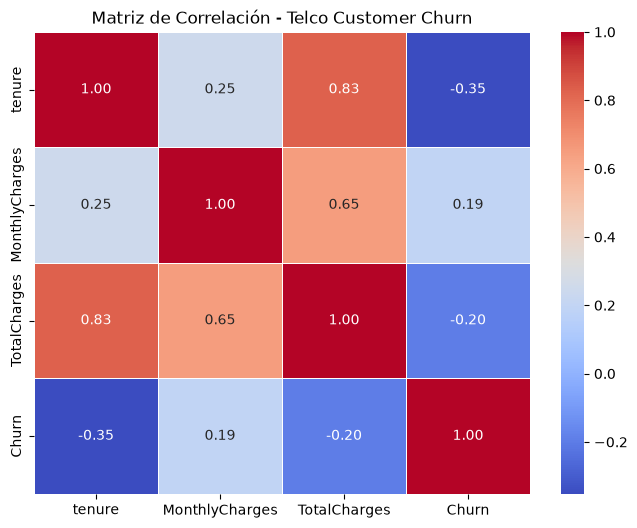
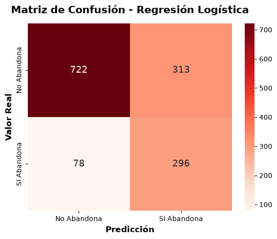
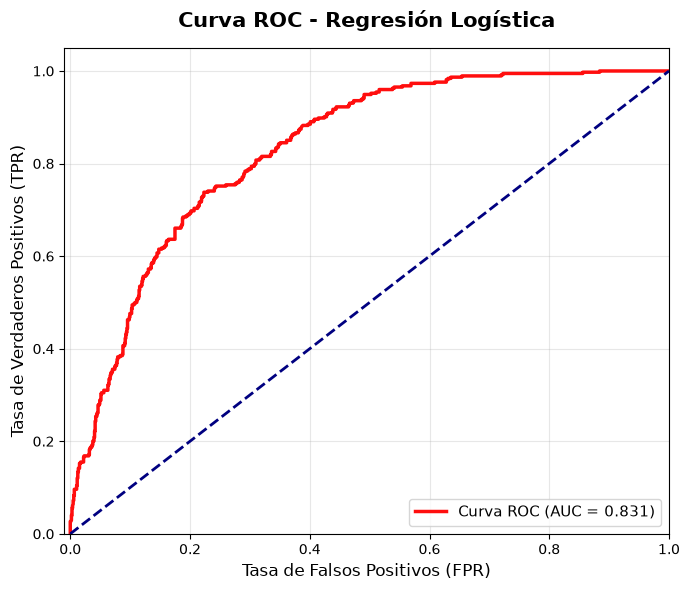
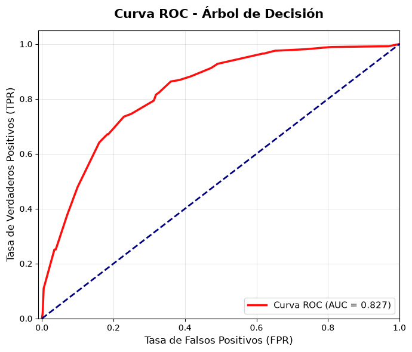
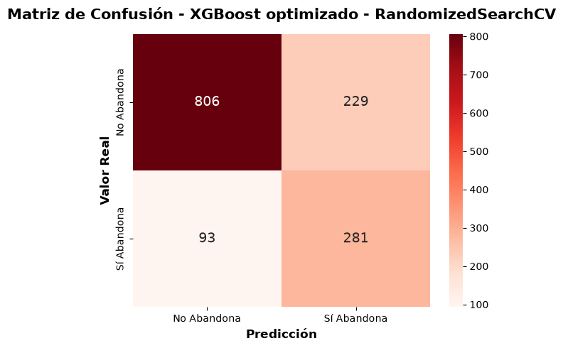
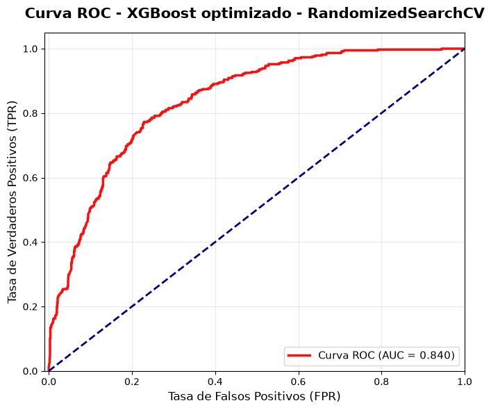
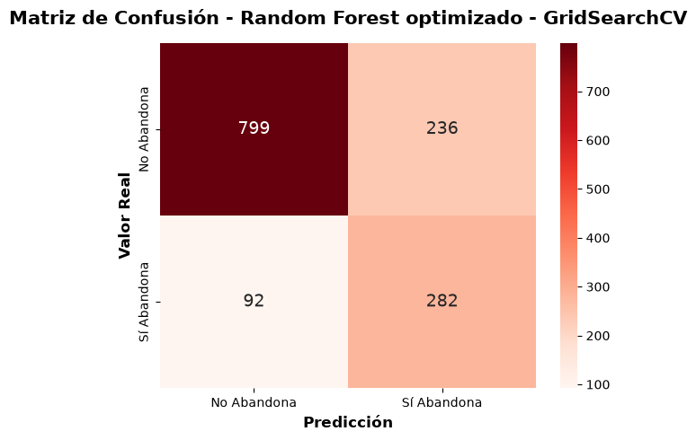
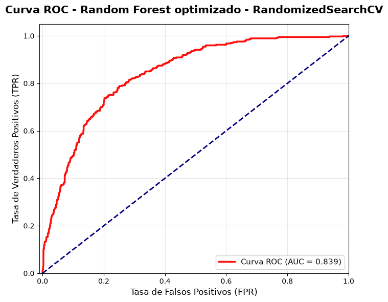
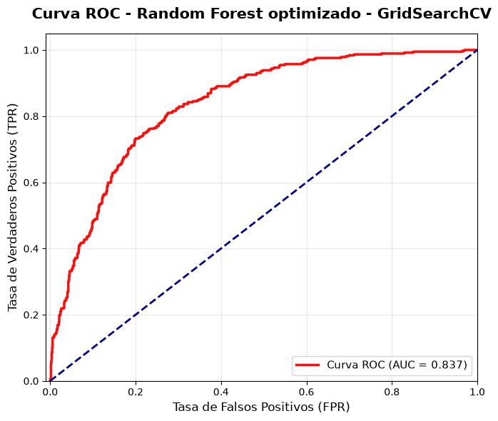

# **Informe Técnico: Implementación de Modelos de Machine Learning en Telecomunicaciones**

    - Equipo de Trabajo: Felipe Huincaman, David  Ramírez Luna
    - Asignatura: Machine Learning
    - Docente: Profesora Jazna Meza Hidalgo
    - Fecha de elaboración: 17 de Noviembre, 2026

# **1. Problema de negocio**
Para las empresas de telecomunicaciones, retener clientes es un desafío enorme. En un mercado donde los usuarios necesitan conectividad a diario, es muy fácil que se vayan a la competencia por un corte, una mala experiencia o una mejor oferta. Por esto, la tasa de abandono (churn) es uno de los mayores riesgos económicos del sector. Si consideramos que conseguir un cliente nuevo cuesta hasta cinco veces más que mantener a uno actual, no controlar la fuga se convierte en una pérdida directa de ingresos que golpea las ganancias de la empresa.

Para reducir este problema, es necesario actuar antes de que el usuario decida irse. Desde el análisis de datos, el desafío consiste en responder a tres preguntas clave: ¿Cómo se agrupan nuestros clientes según sus hábitos de consumo y facturación?, ¿Cuáles de ellos están a punto de cancelar su servicio?, y ¿Cuánto tiempo extra estimamos que cada usuario se quedará con nosotros?

Al entender los distintos perfiles mediante la segmentación, predecir con precisión quiénes se van a ir y calcular su tiempo de permanencia, la empresa puede gastar mejor su presupuesto. Esto le permite al equipo comercial enfocarse en los usuarios que generan más valor, armar campañas a la medida de cada grupo y mejorar el servicio antes de que aparezcan reclamos, haciendo que retener clientes sea la base para que la empresa siga creciendo.

# **2. Objetivos del proyecto**
## **Objetivo general del proyecto:**
Crear una estrategia basada en datos para reducir la pérdida de dinero por el abandono de clientes en la empresa de telecomunicaciones. Esto se apoya en agrupar a los usuarios según cómo se comportan y consumen, detectar a tiempo quiénes van a cancelar, y calcular cuánto tiempo se espera que se quede cada cliente. El fin de esto es armar campañas de fidelización a la medida y gastar mejor el presupuesto del equipo de retención.

## **Objetivos específicos de etapa de Implementación de Modelos de Machine Learning:**
1. Comprensión de la base de clientes: Analizar el historial y las características de los usuarios para encontrar los factores y motivos reales que provocan la cancelación del servicio, entregando datos confiables para tomar decisiones.
2. Segmentación del mercado: Identificar y definir perfiles de clientes que consumen y pagan de forma similar, para que el equipo de marketing pueda armar campañas de fidelización pensadas y adaptadas para cada grupo.
3. Detección de fugas: Identificar con anticipación a los clientes que tienen una alta probabilidad de abandonar la compañía, entregando alertas tempranas para poder actuar antes de que el usuario cierre su cuenta.
4. Proyección de valor y permanencia: Calcular cuánto tiempo más se espera que se queden los usuarios activos, para enfocar el presupuesto de retención en aquellos clientes que dejen más ganancias a largo plazo para la empresa.
5. Validación de la solución: Asegurar que los modelos predictivos sean precisos y confiables, garantizando que las estrategias comerciales y la inversión en retención se basen en cálculos reales que reduzcan los gastos por falsas alarmas o fugas que no vimos venir.
6. Responsabilidad ética: Revisar el impacto comercial y social del proyecto, asegurando que se respete la privacidad de los clientes, que sus datos se usen de forma transparente y que no haya sesgos ni discriminación al armar las campañas de fidelización.

# **3. Definición de KPIs que resolverán el problema de negocio**
Para asegurar que los modelos de Machine Learning generen resultados medibles en la empresa, el desempeño del proyecto se evaluará utilizando los siguientes Indicadores Clave de Desempeño (KPIs):

## **Tasa de Retención Predictiva**
Mide el porcentaje de clientes en riesgo de fuga que logran ser retenidos tras ser contactados por la empresa.
- Se calcula dividiendo la cantidad de clientes que aceptaron la oferta de retención por el total de usuarios que el modelo clasificó como propensos a irse, expresando el resultado como un porcentaje.
- Valida si el modelo de clasificación funciona en la práctica, comprobando si la detección anticipada se traduce en una reducción real de la pérdida de clientes.

## **Proyección de Ingresos Recuperados**
Cuantifica el impacto financiero de retener a un usuario en riesgo, calculando los ingresos que asegura su permanencia en la compañía.
- Se obtiene multiplicando la cuota mensual del cliente por los meses que el modelo de regresión predice que se quedará (variable Tenure). Al sumar estos valores individuales, se obtiene el total de ingresos recuperados.
- Conecta el modelo de regresión con los resultados financieros, permitiendo enfocar los esfuerzos comerciales en retener a los clientes que dejarán mayor rentabilidad a largo plazo.

## **Retorno de Inversión (ROI) de la Retención**
Evalúa la rentabilidad de las campañas de retención al dirigir las ofertas solo a los clientes marcados en riesgo real, comparando lo gastado en descuentos contra los ingresos recuperados.
- Se calcula restando el costo total de la campaña a los ingresos futuros recuperados. Este beneficio neto se divide por el costo de la campaña para revelar el porcentaje de ganancia sobre la inversión.
- Demuestra la eficiencia del algoritmo al reducir los Falsos Positivos. Al evitar entregar descuentos a clientes que no tenían intención de cancelar el servicio, se optimiza el presupuesto.

## **Índice de Fuga por Clúster**
Calcula la proporción de cancelaciones que ocurren dentro de cada segmento de clientes, agrupados previamente según sus patrones de consumo.
- Se obtiene dividiendo la cantidad de clientes que abandonaron el servicio dentro de un segmento (Clúster) por el número total de usuarios en ese mismo grupo, identificando el porcentaje de fuga en ese nicho específico.
- Valida el modelo de clustering y proporciona datos precisos para identificar si el abandono afecta a la base completa de manera uniforme, o si se concentra en un perfil particular de usuarios.

# **4. Metodología utilizada (CRISP-DM)**
Para estructurar y ejecutar este proyecto se adoptó la metodología CRISP-DM, asegurando un desarrollo ordenado y enfocado en resolver el problema del negocio.

1. Comprensión del Negocio: Se evaluó el impacto financiero del abandono de clientes en la empresa. Para abordarlo, se definieron objetivos analíticos de clasificación, regresión y segmentación, cuyo éxito se medirá utilizando los KPIs de retención y rentabilidad definidos previamente.
2. Comprensión de los Datos: Se cargó un dataset de 7043 registros y 21 variables. La exploración inicial mostró un desbalance en la variable objetivo, con una tasa de abandono del 26,5%. Además, se observó que los clientes que abandonan tienen una permanencia media de 17,98 meses frente a los 37,57 meses de los usuarios activos, y pagan cargos mensuales más altos.
3. Preparación de los Datos: El proceso de limpieza y transformación en Python incluyó:
    - Anonimización: Se aplicó la función hash SHA-256 (cifrado irreversible) a los identificadores para proteger la privacidad de los usuarios cumpliendo con la normativa. 
    - Tratamiento de Nulos: Se imputaron con cero los 11 valores nulos detectados en los cargos totales, ya que correspondían a clientes nuevos con cero meses de antiguedad.
    - Revisión de Calidad: Se verificó que no existían registros duplicados ni valores atípicos extremos en las variables numéricas utilizando el método del Rango Intercuartil (IQR). 
4. Modelado: Con los datos procesados mediante pipelines de Scikit-Learn, el desarrollo se dividió en tres enfoques:
    - Clasificación: Modelos supervisados para predecir la probabilidad de que un cliente abandone el servicio.
    - Regresión: Algoritmos supervisados para estimar la cantidad de meses que el usuario permanecerá activo en la empresa.
    - Segmentación (Clustering): Algoritmos no supervisados para agrupar clientes con comportamientos similares y detectar anomalías.
5. Evaluación: El desempeño de los modelos se evaluó primero mediante métricas matemáticas (como Exactitud, Precisión y Recall). Luego, esos resultados se conectaron con los KPIs de negocio para medir su utilidad real para la empresa. 
6. Despliegue: El proyecto se estructuró de forma reproducible, separando los directorios para datos, notebooks de experimentación y código fuente. El entregable final se compone de los notebooks de Jupyter documentados y este informe técnico.

# **5. Descripción General y Calidad del Conjunto de Datos**
El proyecto utiliza el dataset "Telco Customer Churn", que contiene el historial y estado de retención de los clientes de una empresa de telecomunicaciones. El archivo está compuesto por 7043 registros (un cliente por fila) y 21 características.

La información se agrupa en cuatro categorías principales:

- Variable de abandono: Indica si el cliente se dio de baja o canceló su servicio durante el último mes. Está representada en la variable objetivo Churn.
- Servicios suscritos: Detalla los productos contratados por cada cliente. Esto incluye servicio telefónico, múltiples líneas, tipo de internet, seguridad en línea, respaldo en la nube, protección de dispositivos, soporte técnico y streaming de TV y películas.
- Información de la cuenta: Atributos sobre el contrato y el historial de facturación del cliente, tales como la cantidad de meses que lleva en la compañía (tenure), el tipo de contrato, el método de pago, el uso de facturación electrónica, los cargos mensuales y los cargos totales acumulados.
- Información demográfica: Características del perfil del cliente. Incluye su género, un indicador de si es adulto mayor (SeniorCitizen), y su situación familiar para saber si convive con pareja o tiene dependientes.

# **6. Preparación y análisis exploratorio de los datos (EDA)**
Antes de entrenar los modelos, se revisó y exploró la base de datos para asegurar su calidad y entender cómo se comportan los clientes.

## **6.1 Revisión y calidad de los datos**
La revisión de los 7043 registros confirmó que los datos están en muy buen estado:
- Anonimización: Se aplicó un hash SHA-256 a la identificación de cada cliente para proteger la privacidad de los usuarios desde el principio.
- Completitud e Imputación: Los datos vienen limpios. Solo encontramos 11 valores nulos en los cargos totales. Como corresponden a clientes nuevos con cero meses de antiguedad, simplemente se rellenaron con el valor cero.
- Valores atípicos (Outliers): Al evaluar con el método de Rango Intercuartil (IQR), se comprobó que no hay valores atípicos en la antigüedad ni en los cargos mensuales y totales.
- Duplicidad: No se detectaron registros duplicados.   

## **6.2 Análisis Descriptivo y Comportamiento del Cliente**
La exploración de los datos permitió identificar patrones claros en el perfil, el consumo y las tendencias de cancelación que servirán como base para los futuros modelos.

### **Perfil Demográfico y Distribución de Servicios:**
La base está equilibrada por género, con 3555 hombres y 3488 mujeres, y la mayoría es un público joven, ya que el 83,8% no entra en la categoría de adultos mayores (SeniorCitizen). El teléfono es el servicio más contratado, usado por el 90,3% de los usuarios. Por el lado de los contratos, el 55% de los clientes prefiere pagar mes a mes.

### **Ciclo de Vida y Costos:**
- La antigüedad promedio general es de 32,37 meses. Los clientes activos llegan a los 37,57 meses, mientras que las fugas ocurren rápido, a los 17,98 meses en promedio. 
- Los clientes que cancelan pagan tarifas mensuales más altas ($74,44 frente a los $61,27 de los activos). Sin embargo, a largo plazo, los usuarios que se quedan acumulan un gasto total mucho mayor ($2549 frente a $1531).

### **Factores de Fricción y Retención:**
En total, el 26,5% de los usuarios cancela su servicio. Al analizar los datos, encontramos los siguientes motivos principales detrás del abandono:
- Contratos cortos: El plan mensual tiene un 42,7% de abandono. Por el contrario, los contratos con duración a uno o dos años casi no registran fugas.
- Problemas con los pagos: Usar facturación electrónica duplica las cancelaciones frente a la boleta tradicional, llegando a un 33,5%. Además, pagar con cheque electrónico es el mayor factor de riesgo, con un 45,2% de abandonos.
- Servicios extra: Que un cliente contrate seguridad en línea o soporte técnico hace que las cancelaciones caigan del 42% a un 15%. De la misma forma, agregar protección de equipos las baja del 40% al 22%.

# **7. Implementación de modelos de aprendizaje supervisado**
## **7.1 Clasificación**
### **7.1.1 Preparación para el modelado**
#### **Criterios de selección de características**
La selección de las variables predictoras se basó en una validación matemática y otra visual. Para las variables categóricas, usamos la métrica V de Cramér, considerando que un valor sobre 0.3 es un buen indicador de que la característica realmente afecta la decisión de abandono del cliente. Estos niveles de asociación estadística se detallan en el siguiente gráfico:

  
   
  <em>Mapa de Calor de Correlación: V Cramer vs. Churn</em>

Por el lado de las variables numéricas, la matriz de correlación de Pearson mostró relaciones lógicas, destacando la fuerte correlación positiva (0.825) entre la antigüedad y el cargo total acumulado del usuario. Esta dinámica queda en evidencia en la siguiente matriz:

  
   
  <em>Matriz de Correlación</em>

La limpieza final de los datos no se hizo solo con cortes estadísticos estrictos; al revisar los gráficos, decidimos dejar variables como la facturación electrónica (PaperlessBilling), ya que mostraban tendencias muy claras sobre la fuga de clientes, a pesar de que su correlación matemática fuera más baja.

#### **Ingeniería de características**
Para representar mejor el comportamiento del usuario, creamos un transformador personalizado (TelcoFeatureEngineer) que se integra directamente al flujo del modelo. Este código de Python generó cinco variables nuevas:

- Total_Servicios_Extra: Suma de hasta seis servicios adicionales contratados, para medir qué tan "comprometido" está el cliente a la empresa.
- Pago_Automatico: Variable binaria que indica si el cliente usa pago automático, lo que ayuda a evaluar si hay trabas o problemas en el cobro mensual.
- Vive_Solo: Medida de apoyo familiar generada al revisar si el cliente no tiene pareja ni dependientes.
- Aumento_Tarifa: Diferencia calculada entre el cargo mensual actual y el promedio histórico que ha pagado el usuario.
- Perfil_Alto_Riesgo: Variable binaria que marca a los clientes que tienen contrato mes a mes y además usan fibra óptica.

Al mismo tiempo, este paso descartó columnas que no aportaban valor (como el género o el servicio telefónico) y eliminó las variables originales que ya estaban resumidas en las nuevas, dejando el dataset más limpio.

#### **Partición del conjunto de datos**
La variable objetivo Churn se pasó a formato binario (1 y 0) para que los modelos la puedan procesar sin problemas. Luego, los datos se dividieron dejando un 80% para entrenar y un 20% para probar. Aquí aplicamos un muestreo estratificado (stratify=y) para asegurar que la tasa de abandono real del dataset (26.5%) se mantuviera igual en ambos grupos, evitando que el modelo aprenda de forma desbalanceada, y fijamos una semilla aleatoria (random_state=42) para poder replicar los resultados exactos en el futuro.

#### **Pipelines de transformación**
Para estandarizar el procesamiento, usamos un ColumnTransformer que aplica reglas específicas según el tipo de dato. A las variables categóricas nominales se les rellenaron los datos faltantes usando el valor más frecuente y se codificaron con OneHotEncoder, separando las categorías sin inventarles un orden numérico. Las variables binarias y las categóricas que sí tienen un orden lógico (como el tipo de contrato) se trabajaron con OrdinalEncoder para mantener esa estructura. Finalmente, todo esto se unió en un Pipeline final para cada modelo evaluado. Hacerlo así asegura que la creación de variables, la imputación y las transformaciones matemáticas se ejecuten en un solo bloque ordenado, evitando que se filtre información desde los datos de prueba hacia el entrenamiento.

### **7.1.2 Entrenamiento de modelos**
En esta etapa probamos tres modelos de clasificación distintos. Para cada uno, adaptamos el procesamiento previo de los datos según cómo funciona el algoritmo y evaluamos sus resultados, fijándonos principalmente en la clase 1 (clientes que abandonan el servicio).

#### **Modelo de Regresión Logística**
- Transformaciones específicas: Usamos el pipeline numérico base, que incluye el manejo de valores atípicos con Winsorizer y el escalamiento de los datos con MinMaxScaler. Esto es necesario porque la regresión logística es muy sensible a los valores extremos y a la diferencia de escalas entre las variables.
- Configuración del modelo: Aplicamos el algoritmo LogisticRegression con un límite de 1000 iteraciones (max_iter=1000) para asegurar que el entrenamiento termine correctamente. Además, usamos class_weight='balanced' para que el modelo le preste más atención a la clase minoritaria.
- Métricas de rendimiento: En los datos de prueba, logramos una Exactitud (Accuracy) del 72.2%. Al enfocarnos solo en los clientes que se van, obtuvimos una Precisión de 0.486, un Recall de 0.791 y un F1-Score de 0.602. El detalle de sus predicciones y su capacidad para discriminar (AUC) se ven en los siguientes gráficos:

  
   
  <em>Matriz de Confusión - Regresión Logística</em>

Como muestra la matriz de confusión, el modelo logró identificar correctamente 296 fugas (Verdaderos Positivos), reduciendo el riesgo de Falsos Negativos a solo 78 clientes no detectados. El costo de esto fueron 313 Falsos Positivos, es decir, clientes que no se iban a ir pero el modelo los marcó en riesgo.

La curva ROC respalda el rendimiento con un AUC de 0.831, demostrando una buena capacidad general para separar a los clientes que se quedan de los que se van.

  
   
  <em>Curva ROC - Regresión Logística</em>

#### **Modelo de Máquinas de Vectores de Soporte (SVM)**
- Transformaciones específicas: Igual que con la regresión logística, el pipeline incluyó el escalamiento numérico (MinMaxScaler). Este paso es obligatorio para SVM, ya que el algoritmo se basa en calcular distancias para separar las clases.
- Configuración del modelo: Usamos SVC con un kernel radial (kernel='rbf') para poder encontrar relaciones no lineales en los datos. Activamos el cálculo de probabilidades (probability=True) para poder generar la curva ROC, y mantuvimos la configuración de clases balanceadas (class_weight='balanced').
- Métricas de rendimiento: Este modelo obtuvo la Exactitud más alta, con un 73.4%. Para la detección de fugas (clase 1), logró una Precisión de 0.499 y un Recall de 0.767, alcanzando un F1-Score de 0.605. Su rendimiento y el valor AUC se ven a continuación:

  
   
  <em>Matriz de Confusión - SVM</em>

La matriz de confusión indica que el modelo SVM identificó correctamente 287 fugas (Verdaderos Positivos). Aunque su Exactitud general es mayor, este modelo es peor para la retención porque dejó escapar 87 Falsos Negativos (clientes que se fugan sin ser detectados), sumado a 288 Falsos Positivos.

La curva ROC muestra un AUC de 0.813, confirmando que es bueno prediciendo en general, aunque un poco inferior a la Regresión Logística a la hora de separar las clases.

  
   
  <em>Curva ROC - SVM</em>

#### **Modelo de Árbol de Decisión (DecisionTreeClassifier)**
- Transformaciones específicas: A diferencia de los otros modelos, para el árbol de decisión armamos un pipeline numérico aparte que solo rellena los valores faltantes (SimpleImputer). No hicimos escalamiento ni tratamos los valores atípicos, porque los modelos de árboles dividen los datos usando reglas lógicas y no les afecta la escala de las variables.
- Configuración del modelo: Usamos DecisionTreeClassifier limitando su profundidad a 5 niveles (max_depth=5). Esta regla es clave para que el modelo no se sobreajuste (que no memorice los datos de entrenamiento). Además mantuvimos el peso balanceado para las clases.
- Métricas de rendimiento: El árbol logró una Exactitud general del 71.3%. Al predecir las fugas, tuvo la Precisión más baja (0.476), pero destacó consiguiendo el Recall más alto de todos los modelos (0.824), con un F1-Score de 0.603. Sus gráficos y el AUC están aquí:

  
   
  <em>Matriz de Confusión - Árbol de Decisión</em>

Revisando la matriz de confusión, el Árbol de Decisión detectó correctamente 308 fugas (Verdaderos Positivos), y bajó los Falsos Negativos a solo 66 casos. El lado negativo de ser tan sensible es que subieron los Falsos Positivos, llegando a 339 predicciones erróneas de fuga.

La curva ROC confirma esto con un AUC de 0.827, mostrando que clasifica bastante bien y compite de cerca con los otros modelos que probamos.

  
   
  <em>Curva ROC - Árbol de Decisión</em>

### **7.1.3 Modelos de ensamble y optimización de hiperparámetros**
Para mejorar la clasificación, se incorporaron dos modelos de ensamble: Random Forest y XGBoost. Ambos combinan árboles de decisión, pero usan estrategias distintas. Random Forest aplica *Bagging*, entrenando varios árboles y combinando sus predicciones. XGBoost utiliza *Boosting*, construyendo árboles de forma secuencial para corregir errores anteriores.

Primero se evaluaron ambos modelos con una configuración base y luego se buscaron mejores valores para sus hiperparámetros. También se optimizó el Árbol de Decisión para mantener un modelo individual de referencia.

#### **Evaluación inicial de los modelos de ensamble**
Los modelos base se configuraron con los siguientes parámetros:

| Modelo | Configuración inicial |
|---|---|
| Random Forest | 100 árboles, profundidad máxima de 5 niveles y ponderación balanceada de clases. |
| XGBoost | 100 estimadores, profundidad máxima de 5 niveles, tasa de aprendizaje de 0,1 y ponderación de clases de 2,768. |

Ambos utilizaron las mismas particiones de entrenamiento y prueba que los modelos individuales, junto con sus respectivos pipelines de ingeniería de características y preprocesamiento.

**Resultados iniciales en el conjunto de prueba:**

| Modelo | Accuracy | Precisión (Churn) | Recall (Churn) | F1-Score (Churn) | ROC-AUC |
|---|---:|---:|---:|---:|---:|
| Random Forest base | 75,2% | 0,522 | 0,786 | 0,628 | 0,838 |
| XGBoost base | 75,0% | 0,520 | 0,775 | 0,622 | 0,836 |

Los resultados iniciales fueron similares. Random Forest obtuvo valores ligeramente superiores y se utilizó como referencia para medir los cambios tras la optimización.

#### **Metodología de optimización de hiperparámetros**

Se utilizaron dos métodos de búsqueda de Scikit-Learn:

- **RandomizedSearchCV:** prueba una cantidad definida de combinaciones elegidas al azar dentro del espacio de búsqueda, sin evaluar todas las posibilidades.
- **GridSearchCV:** evalúa todas las combinaciones incluidas en una cuadrícula de parámetros.

Ambos métodos utilizaron validación cruzada estratificada de 5 particiones (`StratifiedKFold`, `cv=5`). Así se mantuvo una proporción similar de clientes que permanecen y que abandonan en cada partición.

La búsqueda utilizó F1-Score (`scoring='f1'`) para la clase positiva (Churn = 1). Esta métrica combina Precisión y Recall y permite evaluar el equilibrio entre detectar abandonos y reducir falsas alarmas.

<table>
<tr>
<td valign="top">

### **Configuración general de las búsquedas:**

Espacios de búsqueda para XGBoost:

| Hiperparámetro | RandomizedSearchCV | GridSearchCV |
|---|---|---|
| `n_estimators` | 100, 200, 300, 500 | 100, 200 |
| `max_depth` | 3, 4, 5, 6 | 3, 5 |
| `learning_rate` | 0,01; 0,03; 0,05; 0,1 | 0,05; 0,1 |
| `subsample` | 0,7; 0,8; 1,0 | No incluido |
| `colsample_bytree` | 0,7; 0,8; 1,0 | No incluido |
| `scale_pos_weight` | 1,0; 1,66; 2,0; 2,76 | 1,66; 2,76 |
| Número de Iteraciones| 25 | 16 |

</td>
<td valign="top">

### **Espacios de búsqueda para Random Forest:**

| Hiperparámetro | RandomizedSearchCV | GridSearchCV |
|---|---|---|
| `n_estimators` | 100, 200, 300, 500 | 100, 200 |
| `max_depth` | 5, 8, 12, None | 5, 10, None |
| `min_samples_split` | 2, 5, 10 | No incluido |
| `min_samples_leaf` | 1, 2, 4 | 1, 4 |
| `class_weight` | balanced, balanced_subsample, None | balanced, balanced_subsample |
| Número de Iteraciones | 20 | 24 |

</td>
</tr>
</table>

También se optimizó el Árbol de Decisión. Se evaluaron su profundidad máxima, el mínimo de registros para dividir un nodo, el tamaño mínimo de las hojas y el criterio de división.

#### Resultados de la optimización de XGBoost

Se compararon las configuraciones de RandomizedSearchCV y GridSearchCV, tanto en validación cruzada como en el conjunto de prueba.

| Método | Mejor F1 en CV | F1 Test | Recall Test | Precisión Test | ROC-AUC Test |
|---|---:|---:|---:|---:|---:|
| RandomizedSearchCV | 0,6326 | **0,6357** | 0,7513 | **0,5510** | **0,8398** |
| GridSearchCV | 0,6297 | 0,6208 | **0,8075** | 0,5042 | 0,8381 |

Los mejores hiperparámetros encontrados fueron:

<table>
<tr>
<td valign="top">

### **RandomizedSearchCV:**

| Parámetro | Valor seleccionado |
|---|---:|
| `n_estimators` | 100 |
| `max_depth` | 3 |
| `learning_rate` | 0,05 |
| `subsample` | 0,8 |
| `colsample_bytree` | 0,8 |
| `scale_pos_weight` | 2,0 |

</td>
<td valign="top">

### **GridSearchCV:**

| Parámetro | Valor seleccionado |
|---|---:|
| `n_estimators` | 100 |
| `max_depth` | 3 |
| `learning_rate` | 0,05 |
| `scale_pos_weight` | 2,76 |

</td>
</tr>
</table>

RandomizedSearchCV obtuvo el mayor F1-Score, Precisión y ROC-AUC. GridSearchCV logró el Recall más alto (0,8075), por lo que identificó una mayor proporción de los clientes que abandonaron el servicio.

**Evaluación de las matrices de confusión**

La siguiente matriz corresponde a XGBoost optimizado mediante GridSearchCV:

<table>
<tr>
<td valign="top">

| Valores reales / Predicciones | No abandona | Sí abandona |
|---|---:|---:|
| No abandona | 738 | 297 |
| Sí abandona | 72 | 302 |

</td>
<td valign="top">

</td>
</tr>
</table>

El modelo identificó 302 de los 374 clientes que abandonaron y no detectó 72, lo que corresponde a un Recall de 80,75%. Además, clasificó erróneamente como posibles abandonos a 297 clientes que permanecieron.

En comparación, la configuración de RandomizedSearchCV obtuvo la siguiente matriz:

<table>
<tr>
<td valign="top">

| Valores reales / Predicciones | No abandona | Sí abandona |
|---|---:|---:|
| No abandona | 806 | 229 |
| Sí abandona | 93 | 281 |

</td>
<td valign="top">

</td>
</tr>
</table>

Esta configuración detectó 281 abandonos y omitió 93. Su Recall fue menor (75,13%), pero registró menos falsas alarmas que GridSearchCV (229 frente a 297), por lo que obtuvo una Precisión mayor.

**Evaluación de las curvas ROC**

| Método | ROC-AUC |
|---|---:|
| RandomizedSearchCV | 0,8398 |
| GridSearchCV | 0,8381 |
| XGBoost base | 0,8360 |

**Curvas ROC de XGBoost optimizado mediante RandomizedSearchCV y GridSearchCV**

  
  

Los valores de ROC-AUC son similares. RandomizedSearchCV obtuvo el resultado más alto, aunque la diferencia es pequeña. Por tanto, ambas configuraciones tienen una capacidad de discriminación parecida, pese a sus diferencias en Precisión y Recall.

### **Resultados de la optimización de Random Forest**

En Random Forest también se compararon ambos métodos de búsqueda.

| Método | Mejor F1 en CV | F1 Test | Recall Test | Precisión Test | ROC-AUC Test |
|---|---:|---:|---:|---:|---:|
| RandomizedSearchCV | 0,6296 | **0,6334** | **0,7807** | 0,5328 | **0,8394** |
| GridSearchCV | **0,6313** | 0,6323 | 0,7540 | **0,5444** | 0,8365 |

RandomizedSearchCV obtuvo valores ligeramente superiores de F1-Score, Recall y ROC-AUC en prueba. GridSearchCV logró una Precisión mayor, pero identificó una proporción menor de abandonos.

Los mejores hiperparámetros encontrados por cada método de búsqueda se presentan a continuación:

| Hiperparámetro | RandomizedSearchCV | GridSearchCV |
|---|---:|---:|
| `n_estimators` | 500 | 200 |
| `max_depth` | 8 | `None` |
| `min_samples_split` | 2 | 2 (default)|
| `min_samples_leaf` | 1 | 4 |
| `class_weight` | `balanced` | `balanced` |

RandomizedSearchCV seleccionó una configuración con mayor cantidad de árboles y una profundidad máxima de 8 niveles. GridSearchCV, en cambio, eligió 200 árboles sin establecer un límite explícito de profundidad y con un mínimo de 4 registros por hoja. En este último método, `min_samples_split` no formó parte de la búsqueda y conservó su valor predeterminado.

**Evaluación de las matrices de confusión**

La matriz de Random Forest optimizado mediante RandomizedSearchCV fue la siguiente:

<table>
<tr>
<td valign="top">

| Valores reales / Predicciones | No abandona | Sí abandona |
|---|---:|---:|
| No abandona | 779 | 256 |
| Sí abandona | 82 | 292 |

</td>
<td valign="top">

</td>
</tr>
</table>

El modelo identificó 292 de los 374 abandonos y omitió 82, con un Recall de 78,07%. También registró 256 falsos positivos: clientes que permanecieron, pero fueron clasificados como posibles abandonos.

La configuración de GridSearchCV obtuvo los siguientes resultados:

<table>
<tr>
<td valign="top">

| Valores reales / Predicciones | No abandona | Sí abandona |
|---|---:|---:|
| No abandona | 799 | 236 |
| Sí abandona | 92 | 282 |

</td>
<td valign="top">

</td>
</tr>
</table>

Esta configuración detectó 282 abandonos y omitió 92. Su Recall fue menor que el de RandomizedSearchCV (75,40%), pero redujo los falsos positivos a 236 y alcanzó una Precisión de 0,5444.

**Evaluación de las curvas ROC**

| Método | ROC-AUC |
|---|---:|
| RandomizedSearchCV | 0,8394 |
| GridSearchCV | 0,8365 |
| Random Forest base | 0,8380 |

**Curvas ROC de Random Forest optimizado mediante RandomizedSearchCV y GridSearchCV.**

  
  

RandomizedSearchCV obtuvo el mayor ROC-AUC, aunque la diferencia es pequeña y no muestra una mejora importante frente al modelo base.

#### **Optimización del Árbol de Decisión como modelo de referencia**

También se optimizó el Árbol de Decisión para conservar una referencia individual.

Ambos métodos encontraron la misma configuración: profundidad máxima de 5 niveles (`max_depth=5`) y criterio Gini (`criterion='gini'`).

<table>
<tr>
<td valign="top">

## **Resultados obtenidos DTC:**

| Método | Mejor F1 en CV | F1 Test | Recall Test | Precisión Test | ROC-AUC Test |
|---|---:|---:|---:|---:|---:|
| RandomizedSearchCV | 0,6194 | 0,6208 | 0,7834 | 0,5140 | 0,8162 |
| GridSearchCV | 0,6194 | 0,6208 | 0,7834 | 0,5140 | 0,8162 |

</td>
<td valign="top">

## **Matriz de Confusión DTC:**

| Valores reales / Predicciones | No abandona | Sí abandona |
|---|---:|---:|
| No abandona | 758 | 277 |
| Sí abandona | 81 | 293 |

</td>
</tr>
</table>

El modelo identificó 293 de los 374 abandonos y omitió 81. Obtuvo un Recall de 78,34% y registró 277 falsos positivos. Frente al árbol inicial, mejoró la Precisión y el F1-Score, pero redujo el Recall.

#### **Evaluación de entrenamiento y capacidad de generalización**

Se compararon los resultados de entrenamiento y prueba para revisar el comportamiento de los modelos optimizados.

En XGBoost, las métricas de entrenamiento y prueba fueron las siguientes:

| Configuración | Conjunto | Accuracy | Precisión (Churn) | Recall (Churn) | F1-Score (Churn) |
|---|---|---:|---:|---:|---:|
| RandomizedSearchCV | Train | 0,78 | 0,57 | 0,75 | 0,65 |
| RandomizedSearchCV | Test | - | 0,551 | 0,7513 | 0,6357 |
| GridSearchCV | Train | 0,75 | 0,52 | 0,82 | 0,64 |
| GridSearchCV | Test | - | 0,5042 | 0,8075 | 0,6208 |

Los resultados de entrenamiento y prueba son cercanos, aunque el F1-Score y la Precisión disminuyen en prueba. La diferencia no es marcada.

Para Random Forest, el notebook presenta rangos generales de entrenamiento: Accuracy entre 0,76 y 0,78; Recall entre 0,78 y 0,82; Precisión entre 0,53 y 0,57; y F1-Score entre 0,64 y 0,66. Son valores cercanos a los de prueba, aunque no se entrega el detalle por método de búsqueda.

El Árbol de Decisión también presentó valores cercanos: F1-Score aproximado de 0,63 y Recall de 0,79 en entrenamiento, frente a 0,6208 y 0,7834 en prueba.

Las diferencias entre entrenamiento y prueba no son amplias. De todos modos, esta comparación es una revisión inicial; la validación cruzada aporta una evaluación adicional durante la búsqueda de hiperparámetros.

#### **Comparación de modelos base y optimizados**

Para medir el efecto de la optimización, se compararon las configuraciones iniciales con las obtenidas mediante RandomizedSearchCV y GridSearchCV.

| Modelo | Configuración | F1 Test | Recall Test | Precisión Test | ROC-AUC |
|---|---|---:|---:|---:|---:|
| Random Forest | Base | 0,628 | 0,786 | 0,522 | 0,8380 |
| Random Forest | RandomizedSearchCV | 0,6334 | 0,7807 | 0,5328 | 0,8394 |
| Random Forest | GridSearchCV | 0,6323 | 0,7540 | 0,5444 | 0,8365 |
| XGBoost | Base | 0,622 | 0,775 | 0,520 | 0,8360 |
| XGBoost | RandomizedSearchCV | **0,6357** | 0,7513 | **0,5510** | **0,8398** |
| XGBoost | GridSearchCV | 0,6208 | **0,8075** | 0,5042 | 0,8381 |

En Random Forest, RandomizedSearchCV mejoró moderadamente el F1-Score, la Precisión y el ROC-AUC, pero redujo ligeramente el Recall. GridSearchCV mejoró el F1-Score y la Precisión, aunque obtuvo menor Recall y ROC-AUC que el modelo base.

En XGBoost, RandomizedSearchCV obtuvo el mayor F1-Score, Precisión y ROC-AUC, pero redujo el Recall frente al modelo base. GridSearchCV aumentó el Recall de 0,775 a 0,8075, aunque disminuyó la Precisión y el F1-Score.

La optimización no mejoró todas las métricas al mismo tiempo. Cada configuración ofrece un equilibrio distinto entre detectar abandonos y reducir falsas alarmas.

#### **Comparación global y selección del modelo para el negocio**

Finalmente, se compararon los modelos individuales, los ensambles base y sus versiones optimizadas en el conjunto de prueba. Se consideraron Recall, Precisión, F1-Score, ROC-AUC, falsos negativos y falsos positivos.

| Modelo | Configuración | F1 Test | Recall | Precisión | ROC-AUC | FN | FP |
|---|---|---:|---:|---:|---:|---:|---:|
| Árbol de Decisión | Base | 0,603 | **0,824** | 0,476 | 0,827 | **66** | 339 |
| XGBoost | GridSearchCV | 0,6208 | **0,8075** | 0,5042 | 0,8381 | 72 | 297 |
| Regresión Logística | Base | 0,602 | 0,791 | 0,486 | 0,831 | 78 | 313 |
| Random Forest | Base | 0,628 | 0,786 | 0,522 | 0,838 | 80 | 269 |
| Árbol de Decisión | Optimizado | 0,6208 | 0,7834 | 0,5140 | 0,8162 | 81 | 277 |
| Random Forest | RandomizedSearchCV | 0,6334 | 0,7807 | 0,5328 | 0,8394 | 82 | 256 |
| XGBoost | Base | 0,622 | 0,775 | 0,520 | 0,836 | 84 | 268 |
| SVM | Base | 0,605 | 0,767 | 0,499 | 0,813 | 87 | 288 |
| Random Forest | GridSearchCV | 0,6323 | 0,7540 | 0,5444 | 0,8365 | 92 | 236 |
| XGBoost | RandomizedSearchCV | **0,6357** | 0,7513 | **0,5510** | **0,8398** | 93 | **229** |

*Nota: Las métricas de Precisión, Recall y F1-Score corresponden a la clase positiva (Churn = 1). Los resultados de RandomizedSearchCV y GridSearchCV corresponden a las mejores configuraciones de cada búsqueda. El Árbol de Decisión optimizado obtuvo resultados idénticos con ambos métodos.*

La comparación muestra lo siguiente:

- **Mayor detección de abandonos:** el Árbol de Decisión base conserva el Recall más alto, con 0,824 y 66 falsos negativos.
- **Mejor Recall entre las configuraciones optimizadas:** XGBoost con GridSearchCV alcanza 0,8075 y registra 72 falsos negativos.
- **Mayor equilibrio entre Precisión y Recall:** XGBoost con RandomizedSearchCV obtiene el F1-Score más alto (0,6357), además de la mayor Precisión (0,5510).
- **Menor cantidad de falsas alarmas:** XGBoost con RandomizedSearchCV registra 229 falsos positivos, el menor valor entre las configuraciones comparadas.
- **Mayor ROC-AUC:** XGBoost con RandomizedSearchCV alcanza 0,8398, aunque su diferencia respecto de Random Forest con RandomizedSearchCV (0,8394) es muy pequeña.

**Selección de la alternativa para el negocio**

Entre los modelos optimizados, XGBoost con GridSearchCV obtiene el mayor Recall (0,8075): identifica 302 de los 374 abandonos y omite 72. Es la alternativa optimizada más adecuada cuando se prioriza detectar más abandonos.

El Árbol de Decisión base, sin embargo, alcanza un Recall de 0,824 y registra 66 falsos negativos. XGBoost GridSearchCV detecta seis abandonos menos, pero genera 42 falsas alarmas menos. También obtiene mayor Precisión, F1-Score y ROC-AUC.

La elección depende del costo de cada error. Si se busca reducir al máximo los abandonos no detectados, el Árbol de Decisión base mantiene la ventaja. Si también se busca reducir contactos innecesarios y equilibrar las métricas, XGBoost GridSearchCV es una alternativa competitiva.

En conclusión, **XGBoost optimizado con GridSearchCV es el principal candidato entre los modelos optimizados**, por su mayor Recall y menor cantidad de falsos negativos en ese grupo. Su elección frente al Árbol de Decisión base debe considerar el costo real de ambos tipos de error y el criterio definido para el negocio.

## 7.2 Modelo de Regresión
### 7.2.1 Preparación para el modelado
#### Criterios de selección de variables para el modelo
Se selecciona la variable "tenure" (antigüedad en meses) como variable objetivo (y) debido a que el objetivo estratégico es estimar el ciclo de vida y la permanencia del cliente desde el momento de su adquisición, permitiendo calcular su valor de vida (Customer Lifetime Value - LTV) y diseñar estrategias tempranas de retención.

Para la selección de las variables predictoras (X), se evaluó el coeficiente de correlación de Pearson respecto a la variable objetivo (tenure). Se establecieron como candidatas óptimas aquellas con un valor absoluto |r| >= 0.30, permitiendo filtrar únicamente las variables (cuantitativas y cualitativas codificadas) con una asociación de fuerza moderada a alta para optimizar el modelo.

#### Partición de los datos
En la etapa de preparación y partición de datos, conjunto original se dividió en un 80% para entrenamiento y un 20% para prueba. Al tratarse de un problema de regresión con una variable continua (tenure), se omitió el muestreo estratificado (stratify), ya que este es exclusivo de tareas de clasificación. Adicionalmente, se fijó una semilla de aleatoriedad (random_state=42) para garantizar que la partición sea completamente reproducible en futuras ejecuciones.

#### Pipelines de limpieza y transformación
Tras la selección de variables, se aplicó la transformación y limpieza de los datos según su naturaleza: codificación para las variables categóricas (nominales y binarias) y escalamiento para la cuantitativas, replica de forma directa el estándar de limpieza y preparación utilizado en la etapa de clasificación para garantizar la consistencia en todo el Pipeline.

### 7.2.2 Entrenamiento de modelos
### Regresión Lineal
Se seleccionó el algoritmo de Regresión Lineal (LinearRegression) por su capacidad para modelar la relación directa entre las variables explicativas (X) y la permanencia del cliente (Y) mediante un enfoque claro e interpretable. Su implementación permitió establecer el comportamiento lineal inicial de los datos y sirvió como punto de partida para evaluar si algoritmos más avanzados basados en reglas podían capturar patrones complejos adicionales.

  
   
  <em>Modelo de regresión lineal de los valores reales vs predichos por la antigüedad del cliente</em>

Posteriormente, evaluamos el desempeño del modelo mediante un gráfico de dispersión enfrentando los valores reales de tenure contra las predicciones. La cercanía de los puntos a la línea de identidad (y = x) permite verificar de forma visual e intuitiva la precisión de los ajustes y la magnitud de los erorres de estimación.

#### Métricas de rendimiento
El modelo de regresión lineal explica el 87.67% de la variabilidad en la permanencia del cliente (tenure) (R2 = 0.8767) a partir de los predictores seleccionados. En términos absolutos, el error promedio de las predicciones es de aproximadamente 6.8 meses respecto al valor real.

### Árbol de decisión
Se implementó un Árbol de Decisión (DecisionTreeRegressor) por su interpretabilidad mediante reglas de decisión claras, ideales para traducir los hallazgos en estrategias de negocio entendibles para cualquier audiencia. Su arquitectura segmenta el conjunto de datos en grupos homogéneos, permitiendo predecir la permanencia del cliente de forma más precisa ante patrones de comportamiento no lineales.

Con el fin de asegurar la generalización del Árbol de Decisión y evitar el sobreajuste (overfitting), se restringió la estructura fijando la profundidad máxima en 4 niveles (max_depth = 4) y el tamaño mínimo de hoja en 10 observaciones (min_samples_leaf = 10). Esto genera un conjunto de reglas limpio e interpretable. Adicionalmente, se asignó una semilla de aleatoriedad (random_state = 42) para asegurar la reproducibilidad exacta del entrenamiento.

#### Métricas de rendimiento:
El Árbol de Decisión consolidó un rendimiento sobresaliente al explicar el 92.62% de la variabilidad en la antigüedad del cliente (tenure) a partir de las variables de contrato, cobros y servicios. A nivel operacional, el modelo alcanza un elevado nivel de precisión con un Error Absoluto Medio (MAE) de 4.71 meses (aprox. 4 meses y 21 días), estableciéndose como una herramienta confiable para predecir la permanencia y estimar el valor de la vida del cliente desde su adquisición.

### 7.2.3 Comparación de Desempeño
Para la selección del modelo definitivo, la toma de decisiones se respaldó primordialmente en el **Error Absoluto Medio (MAE)** por ser la métrica más honesta y directa interpretación operativa. A diferencia del Coeficiente de determinación (R2), el MAE refleja la magnitud real del error en la misma unidad de medida (meses de permanencia) y presenta una mayor robustez ante valores extremos, al no penalizar cuadráticamente las desviaciones. Por el contrario, depender exclusivamente del R2 puede resultar engañoso, ya que un valor numérico elevado o cercano a 1.0 no garantiza precisión puntual, depende de la varianza del conjunto de datos y omite la escala del error físico. En consecuencia, el MAE se consolidó como el criterio determinante para garantizar predicciones confiables en el entorno de negocio.

La siguiente tabla resume los resultados que obtuvimos en los datos de prueba:

| Modelo | R2 ( Coeficiente de determinación )| MAE ( Error Absoluto Medio ) |
|---|:---:|:---:|
| Regresión Lineal | 87,6% | 6,7 | 
| Árbol de Decisión | 92,6% | 4,7 |

En el contexto del negocio, el Árbol de Decisión es el modelo más confiable al registrar el MAE más bajo (4.71 meses frente a 6.79 de la Regresión Lineal). Esta reducción de más de dos meses en el error promedio garantiza estimaciones más precisas para la toma de decisiones comerciales.

# 8. Implementación de modelos de aprendizaje no supervisado
## 8.1 Segmentación
### 8.1.1 Preparación para el modelado
#### Criterios de selección de variables para el modelo
Para este modelo se analizó y llegó a la conclusion de que la exclusión del ID del cliente y de la variable de abandono garantiza que los segmentos se formen basándose en verdaderos hábitos de consumo. 

El ID se elimina porque es una variable que no describe el comportamiento del cliente y solo generaría distorsiones matemáticas en los cálculos del algoritmo. 

Por su parte, la variable de abandono se omite para obligar al modelo a agrupar a los usuarios de forma neutral. Si se incluyera desde el principio, el algoritmo simplemente dividiría el data set entre los que se fueron y los que se quedaron, sin revelar patrones nuevos. 

Al agrupar a los clientes exclusivamente por cómo usan el servicio y cruzar esos grupos con el abandono al final del proceso, logramos identificar exactamente qué tipo de cliente es más propenso a irse y por qué.
#### Pipelines de transformación
Al igual que en los modelos de clasificación, para este modelo de segmentación se implementaron pipelines de limpieza y transformación que estandarizan el procesamiento de los datos. Mediante éste se aplicaron reglas automáticas según la naturaleza de cada variable: los datos faltantes se imputaron con el valor más frecuente, las variables nominales se trataron con One-Hot Encoding para evitar jerarquías falsas, y las variables binarias u ordinales conservaron su estructura lógica mediante codificación ordinal.
### 8.1.2 K-Means
Se implementó el algoritmo K-Means con el propósito de descubrir agrupaciones basadas en las similitudes (por distancias y patrones) de los registros. Esto con el fin, de poder distinguir los distintos tipos de clientes en base a sus patrones de consumo. 

Para lograr esto, fue indispensable que el pipeline previo transformara toda la información en una matriz puramente numérica y escalada, dado que K-Means agrupa los perfiles calculando las distancias geométricas (euclidianas) entre ellos.

Para definir la cantidad ideal de grupos, el modelo se iteró y evaluó validando matemáticamente la cohesión interna de los clusters formados (inercia). Cabe destacar, el uso del algoritmo Kneed para la elección de cantidad de clusters óptima, la cual dio como resultado 3.

  
   
  <em>Inercia - K-Means</em>

#### Métricas
Para medir la efectividad a la hora de separar los registros en grupos, fue necesario disponer de métricas para analizar y poder concluir en base a estas el poder de busqueda de patrones y distancias del modelo.

- Inercia (35726.50): Indica qué tan compactos son los segmentos. Aunque su valor absoluto depende de la escala geométrica de los datos, este valor demuestra que con k=3 el modelo logra una reducción media-baja de la varianza interna, de lo cual se puede inferir que si bien se logra un compactamiento de los clústeres, todavia existe una leve dispersión de los registros.
- Silhouette Score (0.2816): Mide qué tan cohesionado está un cliente dentro de su propio grupo frente a qué tan bien separado está de los clusters vecinos. 

  Un puntaje de 0.28 es un resultado bajo, lo cual refleja una distancia entre clusters poco clara, infiriendo la existencia de solapamiento de los mismos. Pero bajo el contexto del problema de negocio, se puede considerar una separación lo suficientemente consistente para poder determinar grupos claros con media - baja probabilidad de error de ubicación de los registros, ya que al tratarse de variables que reflejan patrones de consumo humano, los valores pueden verse afectados por ruido ocasionado por la impredecibilidad del comportamiento humano. 

  Siguiendo con el punto anterior, se confirma que existe una separación válida entre los tres grupos, demostrando que los perfiles encontrados responden en su mayoría a verdaderos patrones de consumo y no al azar.
#### PCA
Al reducir la dimensionalidad a dos componentes, el modelo logra capturar un 54.49% de la varianza total de los datos (32,31% en el primer componente y 22,18% en el segundo). 

Si bien existe una pérdida de información inherente al comprimir la complejidad del dataset en un espacio bidimensional, retener más de la mitad de la varianza original es un nivel de representatividad robusto cuando se trata de variables conductuales como se mencionó en análisis de las métricas. 

La proyección gráfica de estos componentes revela una estructura inherente con el análisis antes mencionado: se identifica un cluster claramente aislado, aunque con cierta dispersión interna, lo que sugiere un grupo con un patrón de consumo relativamente distinto al resto. Por otro lado, los dos clusters restantes presentan un solapamiento relativo, pero mantienen una compactación decente, confirmando que, a pesar de sus similitudes visuales en este plano reducido, el algoritmo original logró diferenciarlos de manera lo suficientemente eficiente.

  
   
  <em>PCA</em>

#### Perfilamiento y análisis para el problema de negocio
Al proyectar las etiquetas generadas por el modelo sobre las variables en su escala natural y cruzarlas con la métrica de abandono (Churn), la segmentación demuestra su aporte en el área estratégica al revelar tres ecosistemas de consumo claramente diferenciados. 

- Cluster 0: Agrupa a usuarios tradicionales de bajo valor monetario, quienes limitan su consumo a telefonía básica sin adopción de banda ancha; su estabilidad recae en barreras contractuales clásicas, presentando un riesgo de fuga marginal.
- Cluster 1: Usuarios volátiles con infraestructura de alto costo (fibra óptica) pero nula penetración de servicios, cuya permanencia es mínima debido a la fragilidad de los contratos mensuales. Éstos representan el perfil de mayor riesgo y al cual deben apuntar las estrategias de retención.
- Cluster 2: Representa a la base consolidada de alto valor, caracterizada por una adopción integral del portafolio (entretenimiento, soporte y seguridad) y una automatización transaccional total, lo que maximiza tanto su ciclo de vida  como su retención. 

Este desglose confirma que, más allá de las métricas obtenidas por el modelo, éste logró decodificar patrones conductuales que podrían explicar las posibles causas operativas detrás de la propensión al abandono.

  
   
  <em>Porcentaje de abandonos por cluster</em>

## Matriz de responsabilidades (RACI)
Esta herramienta de gestión de proyectos permite estructurar, clarificar y asignar los roles dentro de las distintas actividades de un proceso.

Se compone de cuatro roles principales:

- **Responsable (R - Responsible)**: Quien ejecuta y realiza la tarea.
- **Aprobador Final (A - Accountable)**: Quien aprueba formalmente el entregable y rinde cuentas del resultado final.
- **Consultado (C - Consulted)**: Quien aporta información clave o asesoría técnica antes de ejecutar.
- **Informado (I - Informed)**: Quien recibe actualizaciones sobre el avance o estado final de la tarea.

A continuación se presenta la asignación de roles y responsabilidades para cada fase del proyecto, siguiendo la metodología CRISP-DM:

| Tareas del Proyecto | Felipe Huincaman | David Ramírez |
| :--- | :---: | :---: |
| **Definir estructura de carpetas y crear repositorio:** | I | R |
| **Comprensión del Negocio:** Redactar la descripción del problema, objetivos y definir los KPIs estratégicos. | C | R |
| **Preparación y EDA:** Ejecutar la limpieza, transformación de datos e identificar variables relevantes. | R/A | R/A |
| **Modelado No Supervisado**: Implementar técnica para descubrir patrones o segmentos relevantes en los datos. | R/A | C |
| **Modelado Supervisado (Clasificación)**: Implementar modelos. |  R/A | R/A |
| **Modelado Ensamble (Clasificación)**: Implementar modelos. |  R/A | C |
| **Modelado Supervisado (Regresión)**: Implementar modelos. | R/A | R/A |
| **Evaluación:** Interpretar las métricas obtenidas y traducirlas a recomendaciones para el negocio. | R/A | R/A |
| **Impacto Ético**: Evaluar el impacto ético de la solución y documentarlo. | R/A | R/A |
| **Entregable 1**: Consolidar el informe técnico (.md) con la metodología CRISP-DM y hallazgos. | R | R/A |
| **Entregable 2**: Asegurar que los Notebooks .ipynb estén documentados, ordenados y sean completamente ejecutables. | R | R/C |
| **Preparación Defensa**: Elaboración de presentación y estudio cruzado de los modelos. | R/A | R/A |
| **Optimización de hiperparámetros**: Implementar algoritmos de optimización para modelos. | R/A | C |
| **Importancia de características**: Análisis de varia. | R/A | C |
