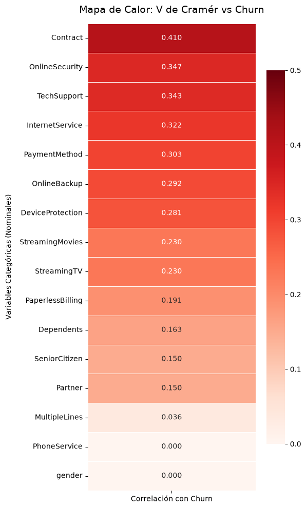
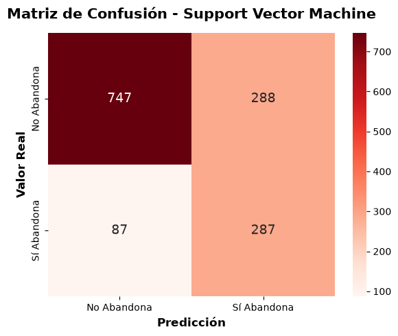
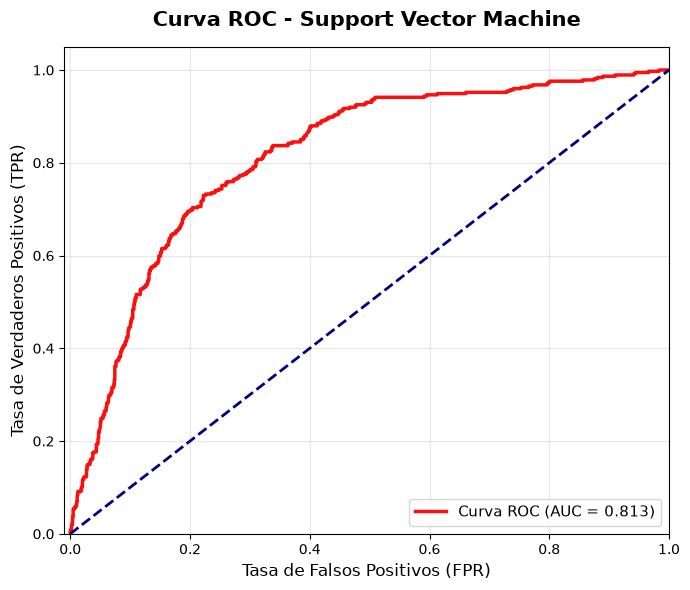
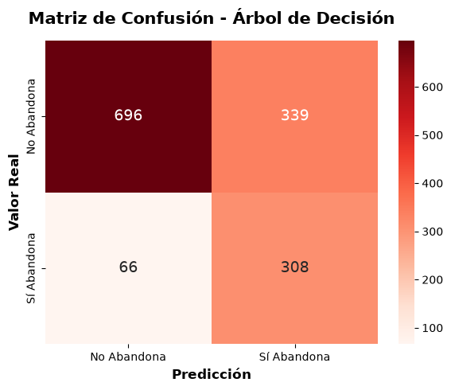
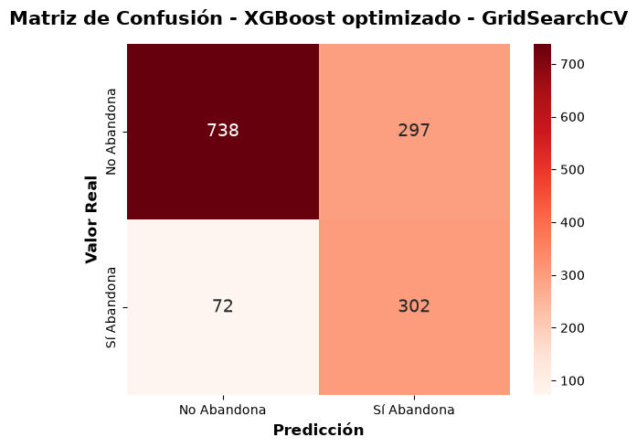
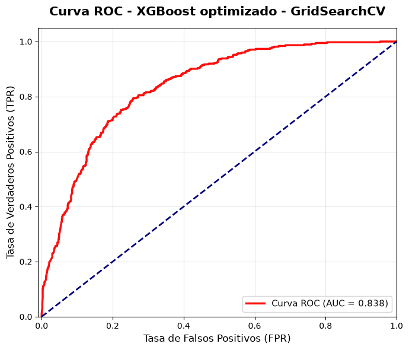
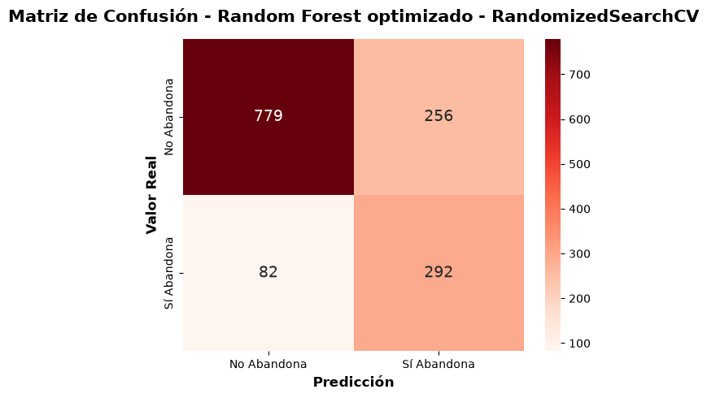
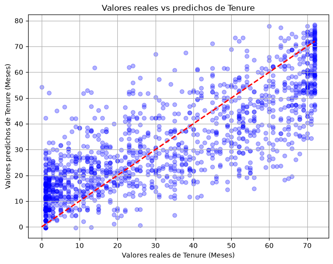
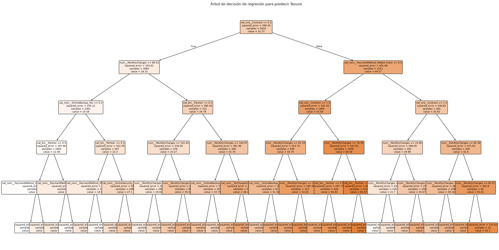

# **Informe Técnico: Implementación de Modelos de Machine Learning en Telecomunicaciones**

    - Equipo de Trabajo: Felipe Huincaman, David  Ramírez Luna
    - Asignatura: Machine Learning
    - Docente: Profesora Jazna Meza Hidalgo
    - Fecha de elaboración: 17 de Noviembre, 2026

# **1. Problema de negocio**
Para las empresas de telecomunicaciones, retener clientes es un desafío enorme. En un mercado donde los usuarios necesitan conectividad a diario, es muy fácil que se vayan a la competencia por un corte, una mala experiencia o una mejor oferta. Por esto, la tasa de abandono (churn) es uno de los mayores riesgos económicos del sector. Si consideramos que conseguir un cliente nuevo cuesta hasta cinco veces más que mantener a uno actual, no controlar la fuga se convierte en una pérdida directa de ingresos que golpea las ganancias de la empresa.

Para reducir este problema, es necesario actuar antes de que el usuario decida irse. Desde el análisis de datos, el desafío consiste en responder a tres preguntas clave: ¿Cómo se agrupan nuestros clientes según sus hábitos de consumo y facturación?, ¿Cuáles de ellos están a punto de cancelar su servicio?, y ¿Cuánto tiempo extra estimamos que cada usuario se quedará con nosotros?

Al entender los distintos perfiles mediante la segmentación, predecir con precisión quiénes se van a ir y calcular su tiempo de permanencia, la empresa puede gastar mejor su presupuesto. Esto le permite al equipo comercial enfocarse en los usuarios que generan más valor, armar campañas a la medida de cada grupo y mejorar el servicio antes de que aparezcan reclamos, haciendo que retener clientes sea la base para que la empresa siga creciendo.

# **2. Objetivos del proyecto**
## **Objetivo general del proyecto:**
Crear una estrategia basada en datos para reducir la pérdida de dinero por el abandono de clientes en la empresa de telecomunicaciones. Esto se apoya en agrupar a los usuarios según cómo se comportan y consumen, detectar a tiempo quiénes van a cancelar, y calcular cuánto tiempo se espera que se quede cada cliente. El fin de esto es armar campañas de fidelización a la medida y gastar mejor el presupuesto del equipo de retención.

## **Objetivos específicos de etapa de Implementación de Modelos de Machine Learning:**
1. Comprensión de la base de clientes: Analizar el historial y las características de los usuarios para encontrar los factores y motivos reales que provocan la cancelación del servicio, entregando datos confiables para tomar decisiones.
2. Segmentación del mercado: Identificar y definir perfiles de clientes que consumen y pagan de forma similar, para que el equipo de marketing pueda armar campañas de fidelización pensadas y adaptadas para cada grupo.
3. Detección de fugas: Identificar con anticipación a los clientes que tienen una alta probabilidad de abandonar la compañía, entregando alertas tempranas para poder actuar antes de que el usuario cierre su cuenta.
4. Proyección de valor y permanencia: Calcular cuánto tiempo más se espera que se queden los usuarios activos, para enfocar el presupuesto de retención en aquellos clientes que dejen más ganancias a largo plazo para la empresa.
5. Validación de la solución: Asegurar que los modelos predictivos sean precisos y confiables, garantizando que las estrategias comerciales y la inversión en retención se basen en cálculos reales que reduzcan los gastos por falsas alarmas o fugas que no vimos venir.
6. Responsabilidad ética: Revisar el impacto comercial y social del proyecto, asegurando que se respete la privacidad de los clientes, que sus datos se usen de forma transparente y que no haya sesgos ni discriminación al armar las campañas de fidelización.

# **3. Definición de KPIs que resolverán el problema de negocio**
Para asegurar que los modelos de Machine Learning generen resultados medibles en la empresa, el desempeño del proyecto se evaluará utilizando los siguientes Indicadores Clave de Desempeño (KPIs):

## **Tasa de Retención Predictiva**
Mide el porcentaje de clientes en riesgo de fuga que logran ser retenidos tras ser contactados por la empresa.
- Se calcula dividiendo la cantidad de clientes que aceptaron la oferta de retención por el total de usuarios que el modelo clasificó como propensos a irse, expresando el resultado como un porcentaje.
- Valida si el modelo de clasificación funciona en la práctica, comprobando si la detección anticipada se traduce en una reducción real de la pérdida de clientes.

## **Proyección de Ingresos Recuperados**
Cuantifica el impacto financiero de retener a un usuario en riesgo, calculando los ingresos que asegura su permanencia en la compañía.
- Se obtiene multiplicando la cuota mensual del cliente por los meses que el modelo de regresión predice que se quedará (variable Tenure). Al sumar estos valores individuales, se obtiene el total de ingresos recuperados.
- Conecta el modelo de regresión con los resultados financieros, permitiendo enfocar los esfuerzos comerciales en retener a los clientes que dejarán mayor rentabilidad a largo plazo.

## **Retorno de Inversión (ROI) de la Retención**
Evalúa la rentabilidad de las campañas de retención al dirigir las ofertas solo a los clientes marcados en riesgo real, comparando lo gastado en descuentos contra los ingresos recuperados.
- Se calcula restando el costo total de la campaña a los ingresos futuros recuperados. Este beneficio neto se divide por el costo de la campaña para revelar el porcentaje de ganancia sobre la inversión.
- Demuestra la eficiencia del algoritmo al reducir los Falsos Positivos. Al evitar entregar descuentos a clientes que no tenían intención de cancelar el servicio, se optimiza el presupuesto.

## **Índice de Fuga por Clúster**
Calcula la proporción de cancelaciones que ocurren dentro de cada segmento de clientes, agrupados previamente según sus patrones de consumo.
- Se obtiene dividiendo la cantidad de clientes que abandonaron el servicio dentro de un segmento (Clúster) por el número total de usuarios en ese mismo grupo, identificando el porcentaje de fuga en ese nicho específico.
- Valida el modelo de clustering y proporciona datos precisos para identificar si el abandono afecta a la base completa de manera uniforme, o si se concentra en un perfil particular de usuarios.

# **4. Metodología utilizada (CRISP-DM)**
Para estructurar y ejecutar este proyecto se adoptó la metodología CRISP-DM, asegurando un desarrollo ordenado y enfocado en resolver el problema del negocio.

1. Comprensión del Negocio: Se evaluó el impacto financiero del abandono de clientes en la empresa. Para abordarlo, se definieron objetivos analíticos de clasificación, regresión y segmentación, cuyo éxito se medirá utilizando los KPIs de retención y rentabilidad definidos previamente.
2. Comprensión de los Datos: Se cargó un dataset de 7043 registros y 21 variables. La exploración inicial mostró un desbalance en la variable objetivo, con una tasa de abandono del 26,5%. Además, se observó que los clientes que abandonan tienen una permanencia media de 17,98 meses frente a los 37,57 meses de los usuarios activos, y pagan cargos mensuales más altos.
3. Preparación de los Datos: El proceso de limpieza y transformación en Python incluyó:
    - Seudonimización: Se aplicó SHA-256 a los identificadores de los clientes y se almacenaron los valores resultantes en customerID_Hash, reemplazando los identificadores originales en el conjunto procesado.
    - Tratamiento de Nulos: Se imputaron con cero los 11 valores nulos detectados en los cargos totales, ya que correspondían a clientes nuevos con cero meses de antiguedad.
    - Revisión de Calidad: Se verificó que no existían registros duplicados ni valores atípicos extremos en las variables numéricas utilizando el método del Rango Intercuartil (IQR). 
4. Modelado: Con los datos procesados mediante pipelines de Scikit-Learn, el desarrollo se dividió en tres enfoques:
    - Clasificación: Modelos supervisados para predecir la probabilidad de que un cliente abandone el servicio.
    - Regresión: Algoritmos supervisados para estimar la cantidad de meses que el usuario permanecerá activo en la empresa.
    - Segmentación (Clustering): Algoritmos no supervisados para agrupar clientes con comportamientos similares y detectar anomalías.
5. Evaluación: El desempeño de los modelos se evaluó primero mediante métricas matemáticas (como Exactitud, Precisión y Recall). Luego, esos resultados se conectaron con los KPIs de negocio para medir su utilidad real para la empresa. 
6. Despliegue: El proyecto se estructuró de forma reproducible, separando los directorios para datos, notebooks de experimentación y código fuente. El entregable final se compone de los notebooks de Jupyter documentados y este informe técnico.

# **5. Descripción General y Calidad del Conjunto de Datos**
## **Fuente de datos y estructura** 
El conjunto de datos se carga desde un archivo CSV alojado en GitHub:

https://raw.githubusercontent.com/david-ramirezl/data/refs/heads/main/Telco_Customer_Churn_Dataset.csv

Durante la carga inicial se identificaron 7043 registros y 21 columnas. En la revisión de los tipos de datos se observó que `TotalCharges` estaba almacenada como texto, a pesar de contener valores numéricos, por lo que se convirtió a tipo numérico. También se transformó `SeniorCitizen`, originalmente representada mediante 0 y 1, en una variable categórica con los valores `No` y `Sí`. Las demás columnas de texto se convirtieron al tipo `object` para facilitar su posterior tratamiento.

La información se agrupa en cuatro categorías principales:

- Variable de abandono: Indica si el cliente se dio de baja o canceló su servicio durante el último mes. Está representada en la variable objetivo Churn.
- Servicios suscritos: Detalla los productos contratados por cada cliente. Esto incluye servicio telefónico, múltiples líneas, tipo de internet, seguridad en línea, respaldo en la nube, protección de dispositivos, soporte técnico y streaming de TV y películas.
- Información de la cuenta: Atributos sobre el contrato y el historial de facturación del cliente, tales como la cantidad de meses que lleva en la compañía (tenure), el tipo de contrato, el método de pago, el uso de facturación electrónica, los cargos mensuales y los cargos totales acumulados.
- Información demográfica: Características del perfil del cliente. Incluye su género, un indicador de si es adulto mayor (SeniorCitizen), y su situación familiar para saber si convive con pareja o tiene dependientes.

# **6. Preparación y análisis exploratorio de los datos (EDA)**
Antes de entrenar los modelos, se revisó y exploró la base de datos para asegurar su calidad y entender cómo se comportan los clientes.

## **6.1 Revisión y calidad de los datos**
La revisión de los 7043 registros permitió identificar los siguientes aspectos relacionados con la calidad de los datos:

- **Seudonimización:** Se aplicó la función hash SHA-256 al identificador de cada cliente, almacenando el resultado en `customerID_Hash` y evitando conservar el identificador original en el conjunto procesado.
- **Completitud e imputación:** Se detectaron 11 valores nulos en `TotalCharges`. Todos correspondían a registros con `tenure = 0`, por lo que se reemplazaron por cero.
- **Valores atípicos:** Mediante el método del Rango Intercuartil (IQR), no se detectaron valores atípicos en `tenure`, `MonthlyCharges` y `TotalCharges`.
- **Duplicidad:** No se encontraron filas completamente duplicadas en el conjunto de datos.  

## **6.2 Análisis Descriptivo y Comportamiento del Cliente**

El análisis exploratorio permitió identificar características de los clientes y diferencias entre quienes permanecen en la compañía y quienes abandonan el servicio.

### **Perfil Demográfico y Distribución de Servicios**

La distribución por género es equilibrada, con 3555 hombres (50,5%) y 3488 mujeres (49,5%). El 83,8% de los clientes no pertenece a la categoría de adultos mayores. Además, el 90,3% tiene contratado servicio telefónico y el 55% mantiene contratos mensuales.

En cuanto al abandono, se registraron 5174 clientes que permanecen en la compañía (73,5%) y 1869 que abandonaron el servicio (26,5%).

### **Distribución de las Variables Numéricas**

Las variables numéricas presentan las siguientes estadísticas:

| Variable | Media | Mediana | Desviación estándar | Mínimo | Máximo |
|---|---:|---:|---:|---:|---:|
| `tenure` | 32,37 | 29,00 | 24,56 | 0,00 | 72,00 |
| `MonthlyCharges` | 64,76 | 70,35 | 30,09 | 18,25 | 118,75 |
| `TotalCharges` | 2283,30 | 1397,48 | 2266,77 | 18,80 | 8684,80 |

La antigüedad presenta una distribución con concentraciones de clientes nuevos y clientes con una permanencia prolongada. Los cargos totales muestran una asimetría positiva, con una mayor concentración de valores bajos y una cola hacia montos más altos.

### **Ciclo de Vida y Costos según el Abandono**

Al comparar los promedios de las variables numéricas según la variable `Churn`, se observan las siguientes diferencias:

| Variable | Clientes activos | Clientes que abandonaron |
|---|---:|---:|
| Antigüedad (`tenure`) | 37,57 meses | 17,98 meses |
| Cargos mensuales (`MonthlyCharges`) | $61,27 | $74,44 |
| Cargos totales (`TotalCharges`) | $2555,34 | $1531,80 |

Los clientes que abandonaron el servicio presentan una antigüedad promedio menor y cargos mensuales superiores. En cambio, quienes permanecen acumulan un mayor monto de facturación total, lo que se relaciona con su mayor tiempo de permanencia.

En el análisis de correlación de Pearson también se identificó una relación positiva entre `tenure` y `TotalCharges` (0,826). Respecto al abandono, se obtuvo una correlación negativa con `tenure` (-0,352), mientras que `MonthlyCharges` presentó una relación positiva (0,193) y `TotalCharges` una relación negativa (-0,199).

### **Factores Asociados al Abandono**

El análisis de las variables categóricas permitió identificar diferencias en las tasas de abandono entre distintos grupos de clientes:

- **Características personales:** No se observaron diferencias importantes entre hombres y mujeres. En cambio, los adultos mayores presentan una tasa de abandono del 41,7%, frente al 23,6% de quienes no pertenecen a esta categoría. También se observaron mayores tasas de abandono entre clientes sin pareja y sin dependientes.
- **Tipo de conexión:** Los clientes con fibra óptica presentan una tasa de abandono del 41,9%, mientras que en quienes utilizan DSL es del 19,0%. Los clientes sin servicio de Internet registran un 7,4%.
- **Seguridad y soporte:** Los clientes que no tienen contratados servicios de seguridad en línea o soporte técnico presentan tasas de abandono cercanas al 41,7%. Entre quienes sí los contratan, las tasas se encuentran aproximadamente entre 14,6% y 15,2%. El respaldo en línea y la protección de dispositivos también muestran diferencias favorables a los clientes que tienen estos servicios.
- **Tipo de contrato:** Los contratos mensuales presentan un 42,7% de abandono, frente al 11,2% de los contratos anuales y el 2,8% de los contratos de dos años.
- **Facturación y pagos:** Los clientes con facturación electrónica presentan una tasa de abandono del 33,5%, frente al 16,3% de quienes utilizan facturación tradicional. El cheque electrónico registra la tasa más alta entre los métodos de pago, con un 45,2%.

Estos resultados muestran asociaciones entre determinadas características de los clientes y el abandono del servicio. Sin embargo, no permiten afirmar que una característica específica sea la causa directa de la cancelación.

# **7. Implementación de modelos de aprendizaje supervisado**

### **Criterios de selección de algoritmos**

La selección de los algoritmos consideró el objetivo de cada tarea, las características de los datos y la posibilidad de comparar métodos con distintos enfoques.

**Clasificación:** El objetivo es predecir si un cliente abandonará el servicio (`Churn`). Se seleccionaron algoritmos capaces de resolver problemas de clasificación binaria:

- **Regresión Logística:** se utilizó como referencia por su enfoque lineal y facilidad de interpretación.
- **SVM:** permite evaluar un método que separa las clases mediante una frontera de decisión.
- **Árbol de Decisión:** se incluyó por su estructura basada en reglas, que facilita la interpretación de las predicciones.
- **Random Forest:** combina varios árboles entrenados en paralelo para reducir la variabilidad de las predicciones.
- **XGBoost:** construye árboles de forma secuencial, buscando corregir los errores de los anteriores.

**Regresión:** El objetivo es estimar la antigüedad del cliente (`tenure`), una variable numérica expresada en meses. Se seleccionaron dos enfoques:

- **Regresión Lineal:** permite representar relaciones lineales entre las variables predictoras y la antigüedad.
- **Árbol de Decisión Regresor:** permite identificar relaciones no lineales mediante reglas y divisiones de los datos.

**Segmentación:** El objetivo es agrupar clientes según sus características y patrones de consumo, sin utilizar una variable objetivo previamente definida.

- **K-Means:** se seleccionó para formar grupos según las distancias entre los clientes y los centros de cada grupo.
- **Selección de grupos:** se consideraron la inercia, mediante el método del codo, y el coeficiente Silhouette.
- **Visualización:** se utilizó PCA para representar los grupos en dos dimensiones y facilitar su interpretación.

Esta selección permite abordar el problema desde tres perspectivas: predecir el abandono, estimar la antigüedad de los clientes y agruparlos según sus características.

## **7.1 Clasificación**
### **7.1.1 Preparación para el modelado**
#### **Criterios de selección de características**
La selección de las variables predictoras consideró su relación estadística con la variable objetivo. Para las variables categóricas se utilizó el coeficiente V de Cramér, que permite medir la fuerza de asociación entre dos variables. Los resultados se utilizaron como referencia para identificar las características con asociaciones más marcadas con el abandono, sin asumir una relación de causalidad.

  
   
  <em>Mapa de Calor de Correlación: V Cramer vs. Churn</em>

Para las variables numéricas se utilizó la correlación de Pearson. La relación positiva más alta se observó entre `tenure` y `TotalCharges`, con un coeficiente de 0,826. También se identificó una relación negativa entre `tenure` y `Churn` (-0,352), y una relación positiva entre `MonthlyCharges` y `Churn` (0,193). Estos resultados describen asociaciones lineales entre las variables, pero no permiten establecer relaciones de causa y efecto.

  
   
  <em>Matriz de Correlación</em>

La limpieza final de los datos no se hizo solo con cortes estadísticos estrictos; al revisar los gráficos, decidimos dejar variables como la facturación electrónica (PaperlessBilling), ya que mostraban tendencias muy claras sobre la fuga de clientes, a pesar de que su correlación matemática fuera más baja.

#### **Ingeniería de características**
Para representar mejor el comportamiento del usuario, creamos un transformador personalizado (TelcoFeatureEngineer) que se integra directamente al flujo del modelo. Este código de Python generó cinco variables nuevas:

- Total_Servicios_Extra: Suma de hasta seis servicios adicionales contratados, para medir qué tan "comprometido" está el cliente a la empresa.
- Pago_Automatico: Variable binaria que indica si el cliente usa pago automático, lo que ayuda a evaluar si hay trabas o problemas en el cobro mensual.
- Vive_Solo: Medida de apoyo familiar generada al revisar si el cliente no tiene pareja ni dependientes.
- Aumento_Tarifa: Diferencia calculada entre el cargo mensual actual y el promedio histórico que ha pagado el usuario.
- Perfil_Alto_Riesgo: Variable binaria que marca a los clientes que tienen contrato mes a mes y además usan fibra óptica.

Al mismo tiempo, este paso descartó columnas que no aportaban valor (como el género o el servicio telefónico) y eliminó las variables originales que ya estaban resumidas en las nuevas, dejando el dataset más limpio.

#### **Partición del conjunto de datos**
La variable objetivo Churn se pasó a formato binario (1 y 0) para que los modelos la puedan procesar sin problemas. Luego, los datos se dividieron dejando un 80% para entrenar y un 20% para probar. Aquí aplicamos un muestreo estratificado (stratify=y) para asegurar que la tasa de abandono real del dataset (26.5%) se mantuviera igual en ambos grupos, evitando que el modelo aprenda de forma desbalanceada, y fijamos una semilla aleatoria (random_state=42) para poder replicar los resultados exactos en el futuro.

#### **Pipelines de transformación**
Para preparar los datos se utilizaron `ColumnTransformer` y `Pipeline`, aplicando transformaciones según el tipo de variable. Las variables categóricas nominales se codificaron mediante One-Hot Encoding, mientras que las binarias se representaron numéricamente con valores 0 y 1. Para la variable ordinal `Contract`, se conservó el orden de sus categorías: mensual, un año y dos años.

Estas transformaciones se integraron en pipelines específicos para cada modelo, evitando realizar el preprocesamiento de forma global antes de la separación entre entrenamiento y prueba.

### **7.1.2 Entrenamiento de modelos**
En esta etapa probamos tres modelos de clasificación distintos. Para cada uno, adaptamos el procesamiento previo de los datos según cómo funciona el algoritmo y evaluamos sus resultados, fijándonos principalmente en la clase 1 (clientes que abandonan el servicio).

#### **Modelo de Regresión Logística**
- **Transformaciones específicas:** Se utilizó un pipeline numérico con imputación por la media (`SimpleImputer`) y escalamiento mediante `MinMaxScaler`. No se incorporó Winsorizer, ya que el análisis previo no detectó valores atípicos según el criterio IQR.
- **Configuración del modelo:** Se utilizó `LogisticRegression` con ponderación balanceada de clases (`class_weight='balanced'`) y semilla aleatoria 42.
- **Métricas de rendimiento:** En el conjunto de prueba obtuvo un Accuracy de 72,0%. Para la clase de abandono alcanzó una Precisión de 0,484, un Recall de 0,791 y un F1-Score de 0,600. El detalle de sus predicciones y su capacidad para discriminar (AUC) se ven en los siguientes gráficos:

  
   
  <em>Matriz de Confusión - Regresión Logística</em>

La matriz de confusión muestra que el modelo identificó correctamente 296 abandonos (Verdaderos Positivos), mientras que 78 clientes que abandonaron no fueron detectados (Falsos Negativos). También clasificó incorrectamente a 316 clientes que permanecieron en la compañía como posibles abandonos (Falsos Positivos).

La curva ROC obtuvo un AUC de 0,830, lo que indica una buena capacidad para distinguir entre clientes que abandonan y clientes que permanecen en la compañía.

  
   
  <em>Curva ROC - Regresión Logística</em>

#### **Modelo de Máquinas de Vectores de Soporte (SVM)**
- **Transformaciones específicas:** Se utilizó `MinMaxScaler` para ajustar la escala de las variables numéricas, ya que SVM es sensible a las diferencias de magnitud entre ellas.
- **Configuración del modelo:** Se utilizó `SVC` con kernel radial (`rbf`) y clases balanceadas. Para obtener probabilidades se incorporó `CalibratedClassifierCV`, utilizando calibración sigmoide y validación cruzada de cinco particiones (`cv=5`, `ensemble=False`).
- **Métricas de rendimiento:** El modelo obtuvo el Accuracy más alto entre los modelos iniciales, con 76,2%. Para la clase de abandono alcanzó una Precisión de 0,539, un Recall de 0,703 y un F1-Score de 0,610. Su rendimiento y el valor AUC se ven a continuación:

  
   
  <em>Matriz de Confusión - SVM</em>

La matriz de confusión muestra que SVM identificó correctamente 263 clientes que abandonaron, pero dejó sin detectar 111 casos. También registró 225 Falsos Positivos. Aunque obtuvo la mayor Exactitud y Precisión entre los modelos iniciales, su Recall de 0,703 fue el más bajo, por lo que identificó una menor proporción de los abandonos reales.

El ROC-AUC obtenido fue de 0,814, el valor más bajo entre los tres modelos iniciales. Esto indica una menor capacidad de discriminación frente a Regresión Logística y Árbol de Decisión.

  
   
  <em>Curva ROC - SVM</em>

#### **Modelo de Árbol de Decisión (DecisionTreeClassifier)**
- Transformaciones específicas: A diferencia de los otros modelos, para el árbol de decisión armamos un pipeline numérico aparte que solo rellena los valores faltantes (SimpleImputer). No hicimos escalamiento ni tratamos los valores atípicos, porque los modelos de árboles dividen los datos usando reglas lógicas y no les afecta la escala de las variables.
- Configuración del modelo: Usamos DecisionTreeClassifier limitando su profundidad a 5 niveles (max_depth=5). Esta regla es clave para que el modelo no se sobreajuste (que no memorice los datos de entrenamiento). Además mantuvimos el peso balanceado para las clases.
- Métricas de rendimiento: El árbol logró una Exactitud general del 71.3%. Al predecir las fugas, tuvo la Precisión más baja (0.476), pero destacó consiguiendo el Recall más alto de todos los modelos (0.824), con un F1-Score de 0.603. Sus gráficos y el AUC están aquí:

  
   
  <em>Matriz de Confusión - Árbol de Decisión</em>

Revisando la matriz de confusión, el Árbol de Decisión detectó correctamente 308 fugas (Verdaderos Positivos), y bajó los Falsos Negativos a solo 66 casos. El lado negativo de ser tan sensible es que subieron los Falsos Positivos, llegando a 339 predicciones erróneas de fuga.

La curva ROC confirma esto con un AUC de 0.827, mostrando que clasifica bastante bien y compite de cerca con los otros modelos que probamos.

  
   
  <em>Curva ROC - Árbol de Decisión</em>

### **7.1.3 Modelos de ensamble y optimización de hiperparámetros**
Para mejorar la clasificación, se incorporaron dos modelos de ensamble: Random Forest y XGBoost. Ambos combinan árboles de decisión, pero usan estrategias distintas. Random Forest aplica *Bagging*, entrenando varios árboles y combinando sus predicciones. XGBoost utiliza *Boosting*, construyendo árboles de forma secuencial para corregir errores anteriores.

Primero se evaluaron ambos modelos con una configuración base y luego se buscaron mejores valores para sus hiperparámetros. También se optimizó el Árbol de Decisión para mantener un modelo individual de referencia.

#### **Evaluación inicial de los modelos de ensamble**
Los modelos base se configuraron con los siguientes parámetros:

| Modelo | Configuración inicial |
|---|---|
| Random Forest | 100 árboles, profundidad máxima de 5 niveles y ponderación balanceada de clases. |
| XGBoost | 100 estimadores, profundidad máxima de 5 niveles, tasa de aprendizaje de 0,1 y ponderación de clases de 2,768. |

Ambos utilizaron las mismas particiones de entrenamiento y prueba que los modelos individuales, junto con sus respectivos pipelines de ingeniería de características y preprocesamiento.

**Resultados iniciales en el conjunto de prueba:**

| Modelo | Accuracy | Precisión (Churn) | Recall (Churn) | F1-Score (Churn) | ROC-AUC |
|---|---:|---:|---:|---:|---:|
| Random Forest base | 75,2% | 0,522 | 0,786 | 0,628 | 0,838 |
| XGBoost base | 75,0% | 0,520 | 0,775 | 0,622 | 0,836 |

Los resultados iniciales fueron similares. Random Forest obtuvo valores ligeramente superiores y se utilizó como referencia para medir los cambios tras la optimización.

#### **Metodología de optimización de hiperparámetros**

Se utilizaron dos métodos de búsqueda de Scikit-Learn:

- **RandomizedSearchCV:** prueba una cantidad definida de combinaciones elegidas al azar dentro del espacio de búsqueda, sin evaluar todas las posibilidades.
- **GridSearchCV:** evalúa todas las combinaciones incluidas en una cuadrícula de parámetros.

Ambos métodos utilizaron validación cruzada estratificada de 5 particiones (`StratifiedKFold`, `cv=5`). Así se mantuvo una proporción similar de clientes que permanecen y que abandonan en cada partición.

La búsqueda utilizó F1-Score (`scoring='f1'`) para la clase positiva (Churn = 1). Esta métrica combina Precisión y Recall y permite evaluar el equilibrio entre detectar abandonos y reducir falsas alarmas.

<table>
<tr>
<td valign="top">

### **Configuración general de las búsquedas:**

Espacios de búsqueda para XGBoost:

| Hiperparámetro | RandomizedSearchCV | GridSearchCV |
|---|---|---|
| `n_estimators` | 100, 200, 300, 500 | 100, 200 |
| `max_depth` | 3, 4, 5, 6 | 3, 5 |
| `learning_rate` | 0,01; 0,03; 0,05; 0,1 | 0,05; 0,1 |
| `subsample` | 0,7; 0,8; 1,0 | No incluido |
| `colsample_bytree` | 0,7; 0,8; 1,0 | No incluido |
| `scale_pos_weight` | 1,0; 1,66; 2,0; 2,76 | 1,66; 2,76 |
| Número de Iteraciones| 25 | 16 |

</td>
<td valign="top">

### **Espacios de búsqueda para Random Forest:**

| Hiperparámetro | RandomizedSearchCV | GridSearchCV |
|---|---|---|
| `n_estimators` | 100, 200, 300, 500 | 100, 200 |
| `max_depth` | 5, 8, 12, None | 5, 10, None |
| `min_samples_split` | 2, 5, 10 | No incluido |
| `min_samples_leaf` | 1, 2, 4 | 1, 4 |
| `class_weight` | balanced, balanced_subsample, None | balanced, balanced_subsample |
| Número de Iteraciones | 20 | 24 |

</td>
</tr>
</table>

También se optimizó el Árbol de Decisión. Se evaluaron su profundidad máxima, el mínimo de registros para dividir un nodo, el tamaño mínimo de las hojas y el criterio de división.

#### **Resultados de la optimización de XGBoost**

Se compararon las configuraciones de RandomizedSearchCV y GridSearchCV, tanto en validación cruzada como en el conjunto de prueba.

| Método | Mejor F1 en CV | F1 Test | Recall Test | Precisión Test | ROC-AUC Test |
|---|---:|---:|---:|---:|---:|
| RandomizedSearchCV | 0,6326 | **0,6357** | 0,7513 | **0,5510** | **0,8398** |
| GridSearchCV | 0,6297 | 0,6208 | **0,8075** | 0,5042 | 0,8381 |

Los mejores hiperparámetros encontrados fueron:

<table>
<tr>
<td valign="top">

### **RandomizedSearchCV:**

| Parámetro | Valor seleccionado |
|---|---:|
| `n_estimators` | 100 |
| `max_depth` | 3 |
| `learning_rate` | 0,05 |
| `subsample` | 0,8 |
| `colsample_bytree` | 0,8 |
| `scale_pos_weight` | 2,0 |

</td>
<td valign="top">

### **GridSearchCV:**

| Parámetro | Valor seleccionado |
|---|---:|
| `n_estimators` | 100 |
| `max_depth` | 3 |
| `learning_rate` | 0,05 |
| `scale_pos_weight` | 2,76 |

</td>
</tr>
</table>

RandomizedSearchCV obtuvo el mayor F1-Score, Precisión y ROC-AUC. GridSearchCV logró el Recall más alto (0,8075), por lo que identificó una mayor proporción de los clientes que abandonaron el servicio.

**Evaluación de las matrices de confusión**

La siguiente matriz corresponde a XGBoost optimizado mediante GridSearchCV:

<table>
<tr>
<td valign="top">

| Valores reales / Predicciones | No abandona | Sí abandona |
|---|---:|---:|
| No abandona | 738 | 297 |
| Sí abandona | 72 | 302 |

</td>
<td valign="top">

</td>
</tr>
</table>

El modelo identificó 302 de los 374 clientes que abandonaron y no detectó 72, lo que corresponde a un Recall de 80,75%. Además, clasificó erróneamente como posibles abandonos a 297 clientes que permanecieron.

En comparación, la configuración de RandomizedSearchCV obtuvo la siguiente matriz:

<table>
<tr>
<td valign="top">

| Valores reales / Predicciones | No abandona | Sí abandona |
|---|---:|---:|
| No abandona | 806 | 229 |
| Sí abandona | 93 | 281 |

</td>
<td valign="top">

</td>
</tr>
</table>

Esta configuración detectó 281 abandonos y omitió 93. Su Recall fue menor (75,13%), pero registró menos falsas alarmas que GridSearchCV (229 frente a 297), por lo que obtuvo una Precisión mayor.

**Evaluación de las curvas ROC**

| Método | ROC-AUC |
|---|---:|
| RandomizedSearchCV | 0,8398 |
| GridSearchCV | 0,8381 |
| XGBoost base | 0,8360 |

**Curvas ROC de XGBoost optimizado mediante RandomizedSearchCV y GridSearchCV**

  
  

Los valores de ROC-AUC son similares. RandomizedSearchCV obtuvo el resultado más alto, aunque la diferencia es pequeña. Por tanto, ambas configuraciones tienen una capacidad de discriminación parecida, pese a sus diferencias en Precisión y Recall.

### **Resultados de la optimización de Random Forest**

En Random Forest también se compararon ambos métodos de búsqueda.

| Método | Mejor F1 en CV | F1 Test | Recall Test | Precisión Test | ROC-AUC Test |
|---|---:|---:|---:|---:|---:|
| RandomizedSearchCV | 0,6296 | **0,6334** | **0,7807** | 0,5328 | **0,8394** |
| GridSearchCV | **0,6313** | 0,6323 | 0,7540 | **0,5444** | 0,8365 |

RandomizedSearchCV obtuvo valores ligeramente superiores de F1-Score, Recall y ROC-AUC en prueba. GridSearchCV logró una Precisión mayor, pero identificó una proporción menor de abandonos.

Los mejores hiperparámetros encontrados por cada método de búsqueda se presentan a continuación:

| Hiperparámetro | RandomizedSearchCV | GridSearchCV |
|---|---:|---:|
| `n_estimators` | 500 | 200 |
| `max_depth` | 8 | `None` |
| `min_samples_split` | 2 | 2 (default)|
| `min_samples_leaf` | 1 | 4 |
| `class_weight` | `balanced` | `balanced` |

RandomizedSearchCV seleccionó una configuración con mayor cantidad de árboles y una profundidad máxima de 8 niveles. GridSearchCV, en cambio, eligió 200 árboles sin establecer un límite explícito de profundidad y con un mínimo de 4 registros por hoja. En este último método, `min_samples_split` no formó parte de la búsqueda y conservó su valor predeterminado.

**Evaluación de las matrices de confusión**

La matriz de Random Forest optimizado mediante RandomizedSearchCV fue la siguiente:

<table>
<tr>
<td valign="top">

| Valores reales / Predicciones | No abandona | Sí abandona |
|---|---:|---:|
| No abandona | 779 | 256 |
| Sí abandona | 82 | 292 |

</td>
<td valign="top">

</td>
</tr>
</table>

El modelo identificó 292 de los 374 abandonos y omitió 82, con un Recall de 78,07%. También registró 256 falsos positivos: clientes que permanecieron, pero fueron clasificados como posibles abandonos.

La configuración de GridSearchCV obtuvo los siguientes resultados:

<table>
<tr>
<td valign="top">

| Valores reales / Predicciones | No abandona | Sí abandona |
|---|---:|---:|
| No abandona | 799 | 236 |
| Sí abandona | 92 | 282 |

</td>
<td valign="top">

</td>
</tr>
</table>

Esta configuración detectó 282 abandonos y omitió 92. Su Recall fue menor que el de RandomizedSearchCV (75,40%), pero redujo los falsos positivos a 236 y alcanzó una Precisión de 0,5444.

**Evaluación de las curvas ROC**

| Método | ROC-AUC |
|---|---:|
| RandomizedSearchCV | 0,8394 |
| GridSearchCV | 0,8365 |
| Random Forest base | 0,8380 |

**Curvas ROC de Random Forest optimizado mediante RandomizedSearchCV y GridSearchCV.**

  
  

RandomizedSearchCV obtuvo el mayor ROC-AUC, aunque la diferencia es pequeña y no muestra una mejora importante frente al modelo base.

#### **Optimización del Árbol de Decisión como modelo de referencia**

También se optimizó el Árbol de Decisión para conservar una referencia individual.

Ambos métodos encontraron la misma configuración: profundidad máxima de 5 niveles (`max_depth=5`) y criterio Gini (`criterion='gini'`).

<table>
<tr>
<td valign="top">

## **Resultados obtenidos DTC:**

| Método | Mejor F1 en CV | F1 Test | Recall Test | Precisión Test | ROC-AUC Test |
|---|---:|---:|---:|---:|---:|
| RandomizedSearchCV | 0,6194 | 0,6208 | 0,7834 | 0,5140 | 0,8162 |
| GridSearchCV | 0,6194 | 0,6208 | 0,7834 | 0,5140 | 0,8162 |

</td>
<td valign="top">

## **Matriz de Confusión DTC:**

| Valores reales / Predicciones | No abandona | Sí abandona |
|---|---:|---:|
| No abandona | 758 | 277 |
| Sí abandona | 81 | 293 |

</td>
</tr>
</table>

El modelo identificó 293 de los 374 abandonos y omitió 81. Obtuvo un Recall de 78,34% y registró 277 falsos positivos. Frente al árbol inicial, mejoró la Precisión y el F1-Score, pero redujo el Recall.

#### **Evaluación de entrenamiento y capacidad de generalización**

Se compararon los resultados de entrenamiento y prueba para revisar el comportamiento de los modelos optimizados.

En XGBoost, las métricas de entrenamiento y prueba fueron las siguientes:

| Configuración | Conjunto | Accuracy | Precisión (Churn) | Recall (Churn) | F1-Score (Churn) |
|---|---|---:|---:|---:|---:|
| RandomizedSearchCV | Train | 0,78 | 0,57 | 0,75 | 0,65 |
| RandomizedSearchCV | Test | - | 0,551 | 0,7513 | 0,6357 |
| GridSearchCV | Train | 0,75 | 0,52 | 0,82 | 0,64 |
| GridSearchCV | Test | - | 0,5042 | 0,8075 | 0,6208 |

Los resultados de entrenamiento y prueba son cercanos, aunque el F1-Score y la Precisión disminuyen en prueba. La diferencia no es marcada.

Para Random Forest, el notebook presenta rangos generales de entrenamiento: Accuracy entre 0,76 y 0,78; Recall entre 0,78 y 0,82; Precisión entre 0,53 y 0,57; y F1-Score entre 0,64 y 0,66. Son valores cercanos a los de prueba, aunque no se entrega el detalle por método de búsqueda.

El Árbol de Decisión también presentó valores cercanos: F1-Score aproximado de 0,63 y Recall de 0,79 en entrenamiento, frente a 0,6208 y 0,7834 en prueba.

Las diferencias entre entrenamiento y prueba no son amplias. De todos modos, esta comparación es una revisión inicial; la validación cruzada aporta una evaluación adicional durante la búsqueda de hiperparámetros.

#### **Comparación de modelos base y optimizados**

Para medir el efecto de la optimización, se compararon las configuraciones iniciales con las obtenidas mediante RandomizedSearchCV y GridSearchCV.

| Modelo | Configuración | F1 Test | Recall Test | Precisión Test | ROC-AUC |
|---|---|---:|---:|---:|---:|
| Random Forest | Base | 0,628 | 0,786 | 0,522 | 0,8380 |
| Random Forest | RandomizedSearchCV | 0,6334 | 0,7807 | 0,5328 | 0,8394 |
| Random Forest | GridSearchCV | 0,6323 | 0,7540 | 0,5444 | 0,8365 |
| XGBoost | Base | 0,622 | 0,775 | 0,520 | 0,8360 |
| XGBoost | RandomizedSearchCV | **0,6357** | 0,7513 | **0,5510** | **0,8398** |
| XGBoost | GridSearchCV | 0,6208 | **0,8075** | 0,5042 | 0,8381 |

En Random Forest, RandomizedSearchCV mejoró moderadamente el F1-Score, la Precisión y el ROC-AUC, pero redujo ligeramente el Recall. GridSearchCV mejoró el F1-Score y la Precisión, aunque obtuvo menor Recall y ROC-AUC que el modelo base.

En XGBoost, RandomizedSearchCV obtuvo el mayor F1-Score, Precisión y ROC-AUC, pero redujo el Recall frente al modelo base. GridSearchCV aumentó el Recall de 0,775 a 0,8075, aunque disminuyó la Precisión y el F1-Score.

La optimización no mejoró todas las métricas al mismo tiempo. Cada configuración ofrece un equilibrio distinto entre detectar abandonos y reducir falsas alarmas.

#### **Comparación global y selección del modelo para el negocio**

Finalmente, se compararon los modelos individuales, los ensambles base y sus versiones optimizadas en el conjunto de prueba. Se consideraron Recall, Precisión, F1-Score, ROC-AUC, falsos negativos y falsos positivos.

| Modelo | Configuración | F1 Test | Recall | Precisión | ROC-AUC | FN | FP |
|---|---|---:|---:|---:|---:|---:|---:|
| Árbol de Decisión | Base | 0,603 | **0,824** | 0,476 | 0,827 | **66** | 339 |
| XGBoost | GridSearchCV | 0,6208 | **0,8075** | 0,5042 | 0,8381 | 72 | 297 |
| Regresión Logística | Base | 0,602 | 0,791 | 0,486 | 0,831 | 78 | 313 |
| Random Forest | Base | 0,628 | 0,786 | 0,522 | 0,838 | 80 | 269 |
| Árbol de Decisión | Optimizado | 0,6208 | 0,7834 | 0,5140 | 0,8162 | 81 | 277 |
| Random Forest | RandomizedSearchCV | 0,6334 | 0,7807 | 0,5328 | 0,8394 | 82 | 256 |
| XGBoost | Base | 0,622 | 0,775 | 0,520 | 0,836 | 84 | 268 |
| SVM | Base | 0,605 | 0,767 | 0,499 | 0,813 | 87 | 288 |
| Random Forest | GridSearchCV | 0,6323 | 0,7540 | 0,5444 | 0,8365 | 92 | 236 |
| XGBoost | RandomizedSearchCV | **0,6357** | 0,7513 | **0,5510** | **0,8398** | 93 | **229** |

*Nota: Las métricas de Precisión, Recall y F1-Score corresponden a la clase positiva (Churn = 1). Los resultados de RandomizedSearchCV y GridSearchCV corresponden a las mejores configuraciones de cada búsqueda. El Árbol de Decisión optimizado obtuvo resultados idénticos con ambos métodos.*

La comparación muestra lo siguiente:

- **Mayor detección de abandonos:** el Árbol de Decisión base conserva el Recall más alto, con 0,824 y 66 falsos negativos.
- **Mejor Recall entre las configuraciones optimizadas:** XGBoost con GridSearchCV alcanza 0,8075 y registra 72 falsos negativos.
- **Mayor equilibrio entre Precisión y Recall:** XGBoost con RandomizedSearchCV obtiene el F1-Score más alto (0,6357), además de la mayor Precisión (0,5510).
- **Menor cantidad de falsas alarmas:** XGBoost con RandomizedSearchCV registra 229 falsos positivos, el menor valor entre las configuraciones comparadas.
- **Mayor ROC-AUC:** XGBoost con RandomizedSearchCV alcanza 0,8398, aunque su diferencia respecto de Random Forest con RandomizedSearchCV (0,8394) es muy pequeña.

**Selección de la alternativa para el negocio**

Entre los modelos optimizados, XGBoost con GridSearchCV obtiene el mayor Recall (0,8075): identifica 302 de los 374 abandonos y omite 72. Es la alternativa optimizada más adecuada cuando se prioriza detectar más abandonos.

El Árbol de Decisión base, sin embargo, alcanza un Recall de 0,824 y registra 66 falsos negativos. XGBoost GridSearchCV detecta seis abandonos menos, pero genera 42 falsas alarmas menos. También obtiene mayor Precisión, F1-Score y ROC-AUC.

La elección depende del costo de cada error. Si se busca reducir al máximo los abandonos no detectados, el Árbol de Decisión base mantiene la ventaja. Si también se busca reducir contactos innecesarios y equilibrar las métricas, XGBoost GridSearchCV es una alternativa competitiva.

En conclusión, **XGBoost optimizado con GridSearchCV es el principal candidato entre los modelos optimizados**, por su mayor Recall y menor cantidad de falsos negativos en ese grupo. Su elección frente al Árbol de Decisión base debe considerar el costo real de ambos tipos de error y el criterio definido para el negocio.

## **7.2 Modelo de Regresión**
### **7.2.1 Preparación para el modelado**
#### **Criterios de selección de variables para el modelo**
Se seleccionó `tenure` como variable objetivo, ya que representa la antigüedad registrada de cada cliente en la compañía, expresada en meses. El modelo busca estimar este valor utilizando otras características del cliente, sus servicios contratados y su información de facturación.

Se utilizó la correlación de Pearson como referencia para analizar la relación entre las variables y `tenure`. Sin embargo, la selección final también consideró el tipo de variable y su utilidad para el modelo. Se definieron las siguientes características predictoras:

| Tipo de variable	| Características seleccionadas |
|---|---:|
| Numérica	| MonthlyCharges |
| Binarias	| Partner, Dependents |
| Nominales	| InternetService, PaymentMethod, TechSupport, StreamingTV, StreamingMovies, DeviceProtection, OnlineSecurity, OnlineBackup |
| Ordinal	| Contract |

Se excluyeron `customerID_Hash` y `Churn`, mientras que `tenure` se mantuvo como variable objetivo. `TotalCharges` no se incorporó al preprocesador, debido a su fuerte relación con la antigüedad y al riesgo de entregar al modelo información que permitiera estimarla de manera poco útil para el objetivo planteado.

#### **Partición de los datos**
Los datos se dividieron en un 80% para entrenamiento (5634 registros) y un 20% para prueba (1409 registros). Se utilizó `random_state=42` para mantener la reproducibilidad. No se aplicó muestreo estratificado, ya que se trata de una tarea de regresión con una variable objetivo numérica.

#### **Pipelines de limpieza y transformación**
Se construyeron pipelines específicos para cada modelo. Ambos aplican imputación por la media a las variables numéricas y por el valor más frecuente a las categóricas. Las variables nominales se codifican con One-Hot Encoding, mientras que las binarias y ordinales utilizan OrdinalEncoder, respetando el orden definido para `Contract`.

La diferencia está en el escalamiento: la Regresión Lineal utiliza `MinMaxScaler` en la variable numérica, mientras que el Árbol de Decisión no lo necesita. Además, se configuró `remainder='drop'` para utilizar únicamente las variables seleccionadas.

### **7.2.2 Entrenamiento de modelos**
#### **Regresión Lineal**
Se utilizó Regresión Lineal (`LinearRegression`) como método de referencia para estimar `tenure`. Este modelo permite representar relaciones lineales entre las variables predictoras y la antigüedad del cliente.

  
   
  <em>Modelo de regresión lineal de los valores reales vs predichos por la antigüedad del cliente</em>

El gráfico compara los valores reales de `tenure` con las predicciones del modelo. Los puntos más cercanos a la línea de identidad (y = x) representan estimaciones más próximas a los valores observados.

#### **Métricas de rendimiento**
En el conjunto de prueba, la Regresión Lineal obtuvo un R² de 0,6454 y un MAE de 11,93 meses. Esto indica que explica aproximadamente el 64,5% de la variabilidad de `tenure`, con un error absoluto promedio cercano a 12 meses.

#### **Árbol de decisión para regresión**
Se implementó `DecisionTreeRegressor` para estimar la antigüedad mediante reglas de decisión. Se estableció una profundidad máxima de 5 niveles (`max_depth=5`) y una semilla aleatoria de 42 para mantener la reproducibilidad. A diferencia de la Regresión Lineal, este modelo no requiere escalamiento numérico.

  
   
  <em>Estructura del Árbol de Decisión para estimar la antigüedad del cliente</em>

#### **Métricas de rendimiento:**
En el conjunto de prueba, el Árbol de Decisión obtuvo un R² de 0,6198 y un MAE de 12,31 meses. Su resultado fue ligeramente inferior al de la Regresión Lineal en ambas métricas.

### **7.2.3 Optimización de hiperparámetros y comparación**

Para mejorar el rendimiento de los modelos se utilizaron `RandomizedSearchCV` y `GridSearchCV`, comparando distintas configuraciones mediante validación cruzada de 5 particiones. La evaluación de las búsquedas se realizó utilizando el error cuadrático medio de raíz (RMSE).

En Regresión Lineal se evaluó el parámetro `fit_intercept`, probando las opciones `True` y `False`. Para el Árbol de Decisión se evaluaron la profundidad máxima, el número mínimo de muestras para dividir un nodo, el tamaño mínimo de las hojas y el criterio de división.

En el caso del Árbol de Decisión se probaron 20 configuraciones mediante RandomizedSearchCV y 32 combinaciones mediante GridSearchCV.

**Resultados en el conjunto de prueba:**

| Modelo | Método | Mejor RMSE CV | RMSE Test | MAE Test | R² Test |
|---|---|---:|---:|---:|---:|
| Regresión Lineal | RandomizedSearchCV | 15,2939 | 14,9414 | **11,9307** | **0,6454** |
| Regresión Lineal | GridSearchCV | 15,2939 | 14,9414 | **11,9307** | **0,6454** |
| Decision Tree Regressor | RandomizedSearchCV | 15,7770 | **15,2520** | **12,1390** | **0,6305** |
| Decision Tree Regressor | GridSearchCV | 15,8251 | 15,4721 | 12,3125 | 0,6198 |

Los dos métodos de búsqueda obtuvieron resultados idénticos para Regresión Lineal. En el Árbol de Decisión, RandomizedSearchCV consiguió mejores resultados que GridSearchCV, con un R² más alto y menores errores.

**Comparación entre entrenamiento y prueba:**

| Modelo | Método | R² Train | MAE Train |
|---|---|---:|---:|
| Regresión Lineal | Ambos métodos | 0,6112 | 12,0305 |
| Decision Tree Regressor | RandomizedSearchCV | 0,6315 | 11,6049 |
| Decision Tree Regressor | GridSearchCV | 0,6110 | 11,9984 |

Las métricas de entrenamiento y prueba presentan diferencias relativamente pequeñas. En estos resultados no se observa una brecha amplia que indique un sobreajuste marcado.

En conjunto, la Regresión Lineal obtuvo los mejores resultados numéricos, con menor RMSE y MAE y un mayor R². La optimización del Árbol de Decisión mediante RandomizedSearchCV permitió mejorar ligeramente sus resultados iniciales, aunque no superó al modelo lineal.

### **7.2.4 Selección del modelo para el negocio**

La Regresión Lineal obtuvo el mejor rendimiento numérico, con un MAE de 11,93 meses y un R² de 0,6454. Sin embargo, el Árbol de Decisión optimizado mediante RandomizedSearchCV alcanzó resultados cercanos, con un MAE de 12,14 meses y un R² de 0,6305.

Aunque la Regresión Lineal presenta menores errores, se propone considerar provisionalmente el Árbol de Decisión optimizado por su facilidad de interpretación, ya que permite representar las estimaciones mediante reglas y puntos de corte sobre las características de los clientes. Su MAE supera al de la Regresión Lineal en aproximadamente 0,21 meses (unos 6 días).

Por lo tanto, la elección del Árbol de Decisión responde principalmente a su interpretabilidad y no a que haya obtenido las mejores métricas globales. Su uso posterior debe considerar esta diferencia de rendimiento y el objetivo específico de la estimación.

# **8. Implementación de Modelos de Aprendizaje No Supervisado**
## **8.1 Segmentación**
### **8.1.1 Preparación para el modelado**
#### **Selección de variables segmentadoras**

Para realizar la segmentación se seleccionaron 13 características relacionadas con la antigüedad, facturación, servicios contratados y situación contractual de los clientes. Se excluyeron el identificador del cliente y la variable `Churn`, para evitar que los grupos se formaran directamente según la condición de abandono.

| Tipo de variable | Características seleccionadas                                                                           |
| ---------------- | ------------------------------------------------------------------------------------------------------- |
| Numéricas        | `tenure`, `MonthlyCharges`, `TotalCharges`                                                              |
| Binarias         | `Partner`, `Dependents`, `PaperlessBilling`                                                             |
| Nominales        | `InternetService`, `OnlineSecurity`, `OnlineBackup`, `DeviceProtection`, `TechSupport`, `PaymentMethod` |
| Ordinal          | `Contract`                                                                                              |

#### **Pipelines de transformación**

Se aplicaron transformaciones según el tipo de variable: imputación por la media y escalamiento MinMax para las numéricas; codificación ordinal para las binarias y el contrato; y One-Hot Encoding para las nominales.

Como resultado, se obtuvo una matriz de 7.043 registros y 26 columnas numéricas, con valores escalados al rango de 0 a 1.

### **8.1.2 Modelo K-Means**

Se utilizó K-Means para agrupar a los clientes según la similitud de sus características. Para determinar la cantidad de grupos se evaluaron valores de K entre 1 y 10 mediante el método del codo, y entre 2 y 10 mediante el coeficiente Silhouette.

El método del codo sugirió utilizar **3 clústeres**, mientras que Silhouette obtuvo su mejor resultado con K = 2 (0,3113). Se seleccionó K = 3 utilizando el resultado del codo como criterio principal.

**Selección del número de clústeres:**

 
  
   
  <em>Figura: Selección de K mediante el método del codo</em>

  
   
  <em>Figura: Evaluación de K mediante Silhouette</em>

**Resultados del modelo definitivo:**

| Indicador               | Resultado |
| ----------------------- | --------: |
| Número de clústeres (K) |         3 |
| Inercia                 | 21.367,16 |
| Silhouette Score        |    0,2598 |

El Silhouette Score de 0,2598 indica una separación limitada entre los grupos, con cierto solapamiento entre sus registros. Por lo tanto, los segmentos permiten identificar perfiles diferenciados, aunque no presentan una separación claramente definida.

### **8.1.3 Reducción de dimensionalidad con PCA**

Se utilizó PCA para representar los 26 atributos transformados en dos dimensiones y facilitar la visualización de los clústeres. Los dos componentes explican conjuntamente el **45,8 % de la variabilidad total**.

- Componente principal 1: 29,2 %.
- Componente principal 2: 16,5 %.

  
   
  <em>Figura: Visualización de los clústeres mediante PCA</em>

La proyección muestra un grupo relativamente separado, mientras que los otros dos presentan un solapamiento visible. Esta representación permite observar parte de la estructura de los datos, aunque no refleja toda la información utilizada por K-Means, que trabajó con las 26 columnas transformadas.

### **8.1.4 Aplicación al problema de negocio**

#### **Abandono por clúster**

Después de asignar los grupos, se cruzaron sus etiquetas con la variable `Churn` para comparar las tasas de abandono.

| Clúster | Clientes que permanecen | Clientes que abandonan |
| ------- | ----------------------: | ---------------------: |
| 0       |                  88,6 % |                 11,4 % |
| 1       |                  52,9 % |             **47,1 %** |
| 2       |                  92,6 % |                  7,4 % |

  
   
  <em>Figura: Proporción de abandono por clúster</em>

El clúster 1 presenta la mayor tasa de abandono, con un 47,1 %. En cambio, los clústeres 0 y 2 muestran tasas considerablemente menores, de 11,4 % y 7,4 %, respectivamente.

#### **Perfil de los segmentos**

Para caracterizar los grupos se calcularon los promedios de las variables numéricas y las categorías más frecuentes de las variables categóricas.

| Indicador            | Clúster 0 |  Clúster 1 | Clúster 2 |
| -------------------- | --------: | ---------: | --------: |
| Antigüedad (meses)   |     50,19 |      19,98 |     30,55 |
| Cargos mensuales ($) |     80,79 |      73,90 |     21,08 |
| Cargos totales ($)   |  4.227,14 |   1.609,78 |    662,60 |
| Tasa de abandono     |    11,4 % | **47,1 %** |     7,4 % |

Las categorías predominantes permiten complementar estos resultados:

- **Clúster 0:** predominan clientes con pareja, contrato de dos años, conexión DSL, servicios adicionales contratados y pago mediante transferencia automática.
- **Clúster 1:** predominan clientes sin pareja ni dependientes, con contrato mensual, fibra óptica, sin servicios adicionales de seguridad o soporte y pago mediante cheque electrónico.
- **Clúster 2:** predominan clientes sin pareja ni dependientes, sin servicio de Internet, con contrato de dos años y pago mediante cheque enviado por correo.

**Arquetipos y recomendaciones para el negocio**

- **Clúster 0 – Cliente consolidado y multiservicio:** presenta la mayor antigüedad y facturación acumulada, junto con una baja tasa de abandono. Se recomienda mantener su satisfacción mediante beneficios de fidelización y ofertas acordes con sus servicios contratados.
- **Clúster 1 – Cliente de fibra óptica con alto riesgo de abandono:** registra la menor antigüedad entre los grupos y una tasa de abandono de 47,1 %. Se propone priorizarlo en las campañas de retención, evaluando ofertas de contratos más largos, servicios de soporte y seguridad, e incentivos para adoptar métodos de pago automático.
- **Clúster 2 – Cliente de telefonía básica y bajo gasto:** presenta los cargos mensuales más bajos y la menor tasa de abandono. Se recomienda mantener la calidad del servicio y evitar campañas costosas que no respondan a sus necesidades.

Los resultados permiten identificar perfiles con distintos niveles de abandono y características de consumo. En particular, el clúster 1 representa el principal segmento de atención para las estrategias de retención. Estas asociaciones ayudan a orientar las decisiones comerciales, aunque no demuestran por sí solas las causas del abandono.

# **Matriz de responsabilidades (RACI)**
Esta herramienta de gestión de proyectos permite estructurar, clarificar y asignar los roles dentro de las distintas actividades de un proceso.

Se compone de cuatro roles principales:

- **Responsable (R - Responsible)**: Quien ejecuta y realiza la tarea.
- **Aprobador Final (A - Accountable)**: Quien aprueba formalmente el entregable y rinde cuentas del resultado final.
- **Consultado (C - Consulted)**: Quien aporta información clave o asesoría técnica antes de ejecutar.
- **Informado (I - Informed)**: Quien recibe actualizaciones sobre el avance o estado final de la tarea.

A continuación se presenta la asignación de roles y responsabilidades para cada fase del proyecto, siguiendo la metodología CRISP-DM:

| Tareas del Proyecto | Felipe Huincaman | David Ramírez |
| :--- | :---: | :---: |
| **Definir estructura de carpetas y crear repositorio:** | I | R |
| **Comprensión del Negocio:** Redactar la descripción del problema, objetivos y definir los KPIs estratégicos. | C | R |
| **Preparación y EDA:** Ejecutar la limpieza, transformación de datos e identificar variables relevantes. | R/A | R/A |
| **Modelado No Supervisado**: Implementar técnica para descubrir patrones o segmentos relevantes en los datos. | R/A | C |
| **Modelado Supervisado (Clasificación)**: Implementar modelos. |  R/A | R/A |
| **Modelado Ensamble (Clasificación)**: Implementar modelos. |  R/A | C |
| **Modelado Supervisado (Regresión)**: Implementar modelos. | R/A | R/A |
| **Evaluación:** Interpretar las métricas obtenidas y traducirlas a recomendaciones para el negocio. | R/A | R/A |
| **Impacto Ético**: Evaluar el impacto ético de la solución y documentarlo. | R/A | R/A |
| **Entregable 1**: Consolidar el informe técnico (.md) con la metodología CRISP-DM y hallazgos. | R | R/A |
| **Entregable 2**: Asegurar que los Notebooks .ipynb estén documentados, ordenados y sean completamente ejecutables. | R | R/C |
| **Preparación Defensa**: Elaboración de presentación y estudio cruzado de los modelos. | R/A | R/A |
| **Optimización de hiperparámetros**: Implementar algoritmos de optimización para modelos. | R/A | C |
| **Importancia de características**: Análisis de varia. | R/A | C |
